# 文档信息

| **项目** | **内容** |
| --- | --- |
| 文档名称 | 基于边缘 AI 的电机智能状态监控系统 · 项目计划书 |
| 版本 | V1.2 |
| 编制 | 汪贤云 |
| 日期 | 2026-10-19 |
| 适用范围 | 毕业设计立项、过程管理与答辩支撑 |

**修订记录**

| **版本** | **日期** | **主要修订内容** |
| --- | --- | --- |
| V1.0 | 2026-10-19 | 首版，按模板框架完成七章内容 |
| V1.1 | 2026-10-19 | 明确电流为辅助观测量；补录遥测帧完整字段定义；按实际固件修正显示布局与网页承载位置；新增「工程瘦身与死代码清理」一节 |
| V1.2 | 2026-10-19 | 补录上板四项验证结果（端到端、异常报警、周期重学、32 min 稳定性），验收标准由「待补足」改为「达成」，待补充项由 8 条减为 7 条 |
| V1.3 | 2026-10-19 | 补齐待补充项：器件采购价（初版核价）、经费来源（个人自筹）、软件授权费（¥0）、风险责任人（本人）、各阶段时间区间与工时（依工作日志推算）；ESP8266 页面部署方式补入附录 |
| V1.4 | 2026-10-19 | 新增「1.2 核心模块选型与接口」（6 个模块小节 + 8 幅插图）；插入系统硬件连接图（图 2-9）与程序流程图（图 3-1）；ESP8266 页面访问地址确定（http://192.168.157.79） |
| V1.5 | 2026-10-20 | 硬件清单按实际下单成交价重算，表 2-1 定为全项目价格基准：新增采购 ¥244.50（在用 ¥194.98 / 备件 ¥49.52）；同步更新 1.1、5.1、5.4 与附录 |

# 一、项目概述

## 1、项目背景

随着工业设备向小型化、分布式部署演进，对电机运行状态的本地化监测需求日益突出。传统做法有两类：一类是**固定阈值报警**，靠人工设定转速、电流的门限，工况一变就要重新调参，换个负载、换块电池立刻失准；另一类是**云端诊断**，把原始数据全部上传到云平台再做模型推理，代价是持续的带宽占用、秒级的响应延迟，以及生产数据外流的顾虑。

本项目针对「单台小型直流电机的状态监测」这一典型场景，设计一套**以 MCU 为算力载体的边缘 AI 监测系统**。系统在 STM32F407 上完成数据采集、特征构造、模型在片学习与异常判定全流程，不依赖云端即可给出「正常 / 异常」结论；同时通过 WiFi 将结构化遥测数据推送到局域网页面，供本地查看与历史回看。

与常规方案相比，本项目的核心取舍是：**把「算力下沉」和「特征精简」同时做到极致**——模型常驻内存 **RAM 3668 B**、Flash 占用 **3108 B**（68 号 ICM 库），单次判定耗时在毫秒级；输入特征从最初设计的 19 维压缩到**唯一一个标量**，用工程手段换取鲁棒性。

## 2、项目目标

- 完成 STM32F407ZGT6 上电机状态采集通道的集成，实现转速（霍尔编码器）、母线电压（ADC）、母线电流（ACS712）三路物理量的稳定采集，并给出可复现的标定方法。三路之中**电流仅作辅助观测量**（本地显示、遥测上报、传感器健康判据、功率回路排障），不进入 AI 模型的输入。
- 构造对**电源波动与负载变化**具有区分能力的归一化特征 `R = 转速 / 母线电压`，并完成特征选择的多方案对比与否定性验证。
- 基于 NanoEdge AI Studio 完成模型训练、验证与选型，产出可在 Cortex-M4 上运行的**在片学习型异常检测库**，最终选定的 68 号 ICM 库实测占用 **RAM 3668 B / Flash 3108 B**（相对上一代 ZSM 库涨约六十倍，换来 28 个百分点的检出率提升，详见设计方案 4.3 节）。
- 实现完整的边缘推理链路：3.2 s 滑动窗口 → `absolute` → `extract_features(n95, peak_value, n25)` → `interleaved` → 与 35 个聚类中心算 L1 距离 → 相似度输出 → 多窗确认报警，并给出阈值标定依据。
- 实现**在线自适应**机制：工况漂移后可自动重建基线，避免「一次报警永久锁死」的失效模式。
- 搭建 OLED 本地显示与 WiFi 遥测两条输出通路，实现运行参数、AI 阶段、相似度的实时可视化。
- 形成可写入论文与答辩的完整证据链：数据集构建方法、离线与上板两套指标、失败方案的归因分析。

## 3、项目范围

为使研究边界清晰、工作量可控，本项目对「做什么」与「不做什么」作如下界定：

| **类别** | **内容** | **说明** |
| --- | --- | --- |
| 范围内：被控对象 | 单台 WHEELTEC MG310 直流有刷电机（带霍尔编码器） | 只研究单机、定工况下的状态判定，不涉及多机协同 |
| 范围内：监测物理量 | 转速、母线电压、母线电流 | 振动量因传感器拆除而放弃，见第三章 2.1 的否定性验证 |
| 范围内：故障类型 | 机械侧异常（输出轴被施加负载 / 卡滞） | 作为唯一异常类别建模，其余故障类型不在本期覆盖 |
| 范围内：AI 部署形态 | MCU 在片学习 + 在片推理（on-board training） | 训练特征不上云，模型随固件发布 |
| 范围内：输出通路 | OLED 本地显示 + WiFi 局域网遥测 | 遥测仅到局域网页面，不接公有云平台 |
| 范围外 | 电机寿命预测、故障类型细分与定位 | 需长周期数据与多类别标注，超出本期资源 |
| 范围外 | 公有云 IoT 平台接入、多设备组网管理 | 属后续扩展方向，本期只保留数据接口 |
| 范围外 | 振动、温度等多模态传感 | 硬件通道已不再具备（MPU6050 已移除） |

## 4、系统设计

| **功能模块** | **具体功能** |
| --- | --- |
| 转速采集 | TIM4 配置为编码器接口模式（TI12 四倍频），采集 MG310 霍尔编码器 A/B 相脉冲 每 100 ms 读取一次计数值增量，换算为转速（r/min） 分辨率 1040 counts/圈（13 线 × 4 倍频 × 20 减速比） |
| 电压采集 | ADC1_IN4 单次软件触发采样，480 周期采样时间，读取板载 1/11 分压后的母线电压 换算公式 `VM = raw / 4095 × 3.3 × 11`，量程覆盖 9~12.6 V 电池区间 |
| 电流采集 | ADC1_IN5 采集 ACS712 输出电压，按 `I = (Vout − 零点) / 0.185` 换算 上电执行 64 次零点校准；停机期间以 α = 0.02 跟踪零点漂移 **采样点用 DWT 周期计数器按 6.25 µs 步进抖动 8 个相位**，避开 PWM 纹波与 10 ms 采样节拍的相位混叠 **定位：只作辅助观测量，不进入 AI 输入**，理由见第三章 2.2 |
| 特征构造 | 计算膝点归一化转速比 `R_new = (rpm / 母线电压) × 8 / (duty − 50)` 维护 32 点滑窗（32 × 100 ms = 3.2 s），每次推进 1 点；窗内取峰峰值 dR 作为判决量 转速低于 20 rpm、电压无效或占空比 ≤ 50 时停止推点，避免污染窗口 |
| 边缘 AI 推理 | 窗口填满后送入 NanoEdge **ICM** 库：`absolute` → `extract_features(n95, peak_value, n25)` → `interleaved` → 与 35 个聚类中心算 L1 距离 输出 0~100 的相似度，100 表示与学到的正常形态完全一致 **库带预训练知识，上电即进入检测态**，不需要现场学基线 |
| 状态判定与报警 | 相似度低于阈值 32 连续 2 窗置报警；回升并连续 2 窗高于阈值则自动解除 **并联一道 dR 显式判据**：窗内峰峰值超过 1.0 rpm/V 且连续 2 窗同样置报警 相似度低于 20 视为硬故障，此时冻结基线更新 |
| 在线自适应 | 运行期累计 6000 次检测（相似度 ≥ 20 时计数）后做一次**增量** learn，把基线缓慢拉到当前工况 停机持续 0.5 s 只清报警与计数、**保留预训练知识**，起转即恢复判定，不必重学 |
| 人机交互 | OLED 分 3 行大字（转速 / 电流 / R）+ 2 行小字（母线电压 / 相似度 / 状态；AI 阶段 / 档位 / 运行秒数） 三按键实现急停、档位加、档位减，档位直接映射 PWM 占空比 |
| 无线遥测 | USART3 以 57600 8N1 驱动 ESP8266（D1 mini），按固定帧格式推送运行参数与 AI 状态 局域网内浏览器访问页面，实时查看数值与趋势 |

## 5、整体架构

本系统采用「现场感知 — 边缘计算 — 本地交互 — 无线遥测」的四层架构，硬件核心为一块 STM32F407ZGT6 开发板，外接电机驱动、传感与通信模块，具体架构如下：

| **层级** | **组成** | **核心职责** |
| --- | --- | --- |
| 第四层：遥测展示层 | 局域网页面（单文件 HTML） | 运行参数与 AI 状态的实时刷新 历史曲线与异常事件回看 |
| 第三层：本地交互层 | OLED（SSD1306 / SSD1315 兼容，128×64，8 页） 板载三按键 | 3 行大字：转速 / 电流 / R 2 行小字：母线电压 / 相似度 / 状态，AI 阶段 / 档位 / 运行秒数 三按键：急停、档位加、档位减 |
| 第二层：边缘计算层 | STM32F407ZGT6，168 MHz | 采集：TIM4 编码器 / ADC1_IN4 母线 / ADC1_IN5 电流 特征：R_new = (rpm / V) × 8 / (duty − 50)，判决量 dR = 窗内峰峰值，32 点滑窗（3.2 s） 推理：NanoEdge **ICM** 库（RAM 3668 B / Flash 3108 B），带预训练知识 决策：dR 门限 + 相似度双判据、多窗确认、增量学习 调度：TIM7 1 ms 节拍，10 ms 任务块，100 ms 推点 |
| 第一层：现场感知与执行层 | MG310 电机 + 霍尔编码器（1040 counts/圈） D153C 驱动模块 母线分压网络 / ACS712 电流采样 | 物理量采集与电机驱动 |

层间接口：第四层与第三层经 WiFi（USART3 / AT 指令 / 57600 8N1）单向连接；第三层通过 `UI_Data` 结构体从第二层单向读取；第二层向下经 GPIO、定时器与 ADC 直接操作感知层。

架构上的三个关键设计点：

1. **算力与数据不出板**：模型推理全在 MCU 内完成，对外只发结构化结果（转速、R、相似度、报警标志），不发原始波形，带宽占用与隐私风险同时降到最低。
2. **采样与推理解耦**：采集在 1 ms 硬节拍中断里打点，推理在 10 ms 主循环任务块里按条件触发，互不阻塞；推理耗时不会反过来拉长采样周期。
3. **失效安全优先**：任何传感器失效（转速无脉冲、电压越界、电流零点异常）都会强制显示 WARN 而不是继续输出「正常」，避免把失效误呈现为健康。

## 6、开发工具

### 6.1 软件开发工具

| **工具名称** | **核心用途** | **关键说明** |
| --- | --- | --- |
| Keil MDK-ARM 5.14 | 代码编写、编译、链接、在线调试 | 对 STM32 标准外设库支持完善；工程按 CORE / FWLIB / USER / HARDWARE 四层组织，编译产物输出至 OBJ 目录 |
| STM32F4xx 标准外设库 V1.4 | 提供外设寄存器定义、启动文件与库函数 | 直接调用封装好的库函数，无需手写寄存器配置；**所有外设初始化结构体必须先清空再赋值**，否则残留位会导致影子寄存器装载失败 |
| NanoEdge AI Studio 5.2.0 | 数据集导入、Benchmark、Validation、库生成与仿真 | 目标平台选 STM32F4 Series，缓冲 32 KB RAM / 512 KB Flash；生成物包含静态库、模型参数 JSON 与桌面仿真器 |
| J-Link 驱动与 Commander | 固件下载、内存读取、远程状态观测 | 除常规下载外，还用于运行期读内存观察内部状态；**下载前必须先关闭 ADC-DMA**，否则烧写算法会与 DMA 争用 RAM |
| Git（可选） | 源码版本管理 | 每次改动前留存 `.bak` 备份，便于回滚与差异对比 |

### 6.2 通信调试工具

| **工具名称** | **核心用途** | **关键说明** |
| --- | --- | --- |
| 串口调试助手 | 查看 USART1 调试输出；测试 ESP8266 的 AT 指令响应 | 波特率 115200 8N1；可切换十六进制 / ASCII 显示，用于核对遥测帧内容 |
| J-Link Commander 脚本 | 批量读取内部变量，观测 AI 状态机与窗口填充进度 | 脚本需 LF 行尾、纯 ASCII 路径、以 `exit` 结尾；不带 `device` 参数才不会复位目标 |
| NanoEdge 桌面仿真器 | 用 `libneai.dll` 在 PC 上重放数据，验证模型判定 | 可对比「离线判定」与「板上判定」的差异，但**不能替代上板实测**，板上噪声远大于离线数据 |
| 浏览器开发者工具 | 查看遥测页面收到的数据帧与刷新情况 | 用于排查 WiFi 断连、帧格式错误和页面卡顿 |

### 6.3 辅助工具

| **工具名称** | **核心用途** | **关键备注** |
| --- | --- | --- |
| 万用表 | 核对母线电压采样精度、ACS712 输出电压、驱动模块供电 | 与固件读数交叉验证，是排查「读数异常」与「通道损坏」的第一手段 |
| 逻辑分析仪（可选） | 抓取 PWM、编码器 A/B 相、USART 时序 | 用于确认脉冲是否真实存在，避免把「无脉冲」误判为软件问题 |
| Python + NumPy / Matplotlib | 数据集构建、阈值标定、离线重放与图表生成 | 全部脚本可复现，是论文图表的数据来源 |
| Excel / WPS 表格 | 采集数据整理与快速统计 | 用于生成均值、标准差、分位数等基础指标 |

# 二、硬件设计

## 1、模块链接

### 1.1 硬件清单

| **设备名称** | **型号 / 规格** | **数量** | **用途** | **单价** | **链接** |
| --- | --- | --- | --- | --- | --- |
| 单片机开发板 | STM32F407ZGT6（精畅「神舟号」V2.0） | 1 块 | 系统主控，承担采集、推理、显示与通信调度 | 已有（实验室提供，不计新增支出） | — |
| 直流减速电机 | WHEELTEC MG310，带霍尔编码器，13 线 / 20 减速比 | 1 台 | 被监测对象，提供转速脉冲与机械负载通道 | ¥33.90 / 台，小计 ¥33.90 | [下单页](https://e.tb.cn/h.jX8aIya7WKkPY1K?tk=fhauTF9JhIC) |
| 电机驱动模块 | D153C 双路直流电机驱动（TB6612 兼容接口） | 2 块（在用 1） | 接收 PWM 与方向信号，驱动电机并引出母线采样点 | ¥39.00 / 个，小计 ¥78.00 | [下单页](https://e.tb.cn/h.j2sAuF3igdbRbPw?tk=AvBFTF957G1) |
| 电流传感器 | ACS712-05B（5 A 量程，185 mV/A） | 2 个（在用 1） | 串联于驱动板输出与电机之间，采集电枢相电流 | ¥5.42 / 个，小计 ¥10.84 | [下单页](https://e.tb.cn/h.j2HQhSjVjTxcppu?tk=bghtTF9s5au) |
| OLED 显示屏 | 0.96 寸 OLED（SSD1306 / SSD1315 兼容），I2C 接口，128×64 | 1 块 | 本地显示运行参数与 AI 状态 | ¥9.87 / 个，小计 ¥9.87 | [下单页](https://e.tb.cn/h.jcSevcz3Vr0o0tz?tk=QnIjTF9SFbg) |
| WiFi 模块 | ESP8266 D1 mini（已焊接） | 1 块 | 经 USART3 接收 42 字节遥测帧并承载监控页面 | ¥20.19 / 个，小计 ¥20.19 | [下单页](https://e.tb.cn/h.jWhWctWdr6B5Wdd?tk=lR1lTF9Egr1) |
| USB 转串口 | CH340C（板载） | 2 路 | 调试串口与固件下载辅助通道 | ¥5.10 / 条，小计 ¥10.20 | [下单页](https://e.tb.cn/h.jcSLazxjK9hihpY?tk=iMM1TF9visS) |
| 电池组 | E326S 锂电池组（3S，标称 11.1 V / 满电 12.6 V） | 1 组 | 系统与电机供电 | ¥56.00 / 个，小计 ¥56.00 | [下单页](https://e.tb.cn/h.jW6LgVjvrxZWCjm?tk=wKPqTF961sq) |
| J-Link 仿真调试器 | J-Link v8 SWD（兼容 J-Link OB TYPE-C） | 1 个 | 调试与下载目标板 | ¥14.70 / 个，小计 ¥14.70 | [下单页](https://e.tb.cn/h.j2HS7sDV0NNYsma?tk=vEySTF9p9IJ) |
| 杜邦线 | 公母 20 cm + 母母 20 cm + 公公 20 cm | 各 1 排 | 模块间连接 | ¥3.60 / 排，小计 ¥10.80 | [下单页](https://e.tb.cn/h.jcSn8LkLjNCGPyf?tk=x2rMTF9uBjK) |
| **合计** | — | — | 开发板不计新增支出 | **¥244.50** | 在用 ¥194.98 / 备件 ¥49.52 |

> 说明：单价为 **2026-10-20 实际下单成交价**，链接为下单时的商品页（长链接可能失效，以型号为准）。**本表是项目成本核算与器件复现的唯一基准**，全书及其他文档涉及价格处均以此表为准。开发板由实验室提供，不计新增支出；合计 **¥244.50**，其中在用 ¥194.98、备件 ¥49.52（备件为 D153C 1 块、ACS712 1 个、CH340C 1 条）。已移除的 GY-521（MPU6050，¥28.50）不列入本表，其费用计入研发耗材。

### 1.2 核心模块选型与接口

本项目硬件共由 6 类模块构成。以下按「主控 — 驱动 — 电机 — 感知 — 通信 — 电源」的信号链顺序，给出各模块的接口示意图（或实物照片）与选型说明；图中右侧为关键参数，正文不再重复列表。

#### 1.2.1 STM32F407ZGT6 主控开发板

主控采用精畅「神舟号」V2.0 开发板，搭载 STM32F407ZGT6（Cortex-M4，168 MHz）。板载资源直接覆盖了本项目的全部人机交互与调试需求：0.96 寸 OLED 与三个轻触按键构成显示与输入通道，CH340C 提供 USB 转串口调试通道，LED0 用作报警指示。H2 排针引出电机编码器信号与母线分压采样点，是功率侧与控制侧的唯一信号交汇处。需要特别注意 PA1 / PA7 / PC3 / PC4 已被板载以太网 PHY 占用，选引脚时必须避开。模块接口如图 2-1 所示。

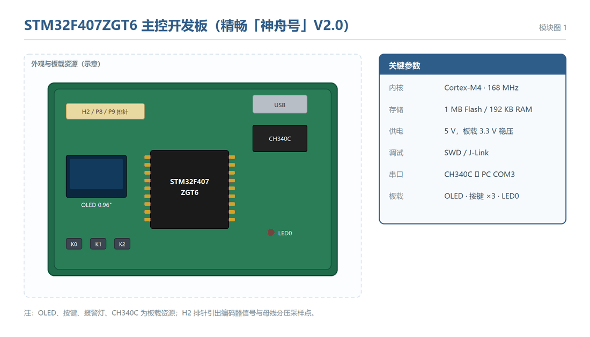

#### 1.2.2 D153C 双路直流电机驱动板

驱动板基于 TB6612 双 H 桥方案，每路连续电流 1.2 A，满足 MG310 电机额定工况。控制信号仅需三根：BIN1 / BIN2（方向与 PWM）与 STBY（使能，必须拉高）。板载 5 V 稳压输出为 ACS712、D1 mini 与编码器供电，省去独立电源模块；板载 10k+1k 分压网络将母线电压降为 1/11 后从 H2-5 引出，供 ADC 采样。接口如图 2-2 所示，实物如图 2-3 所示。

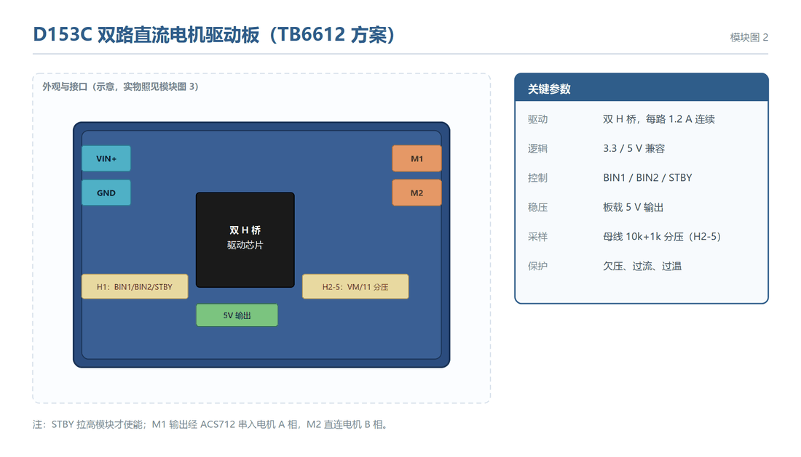

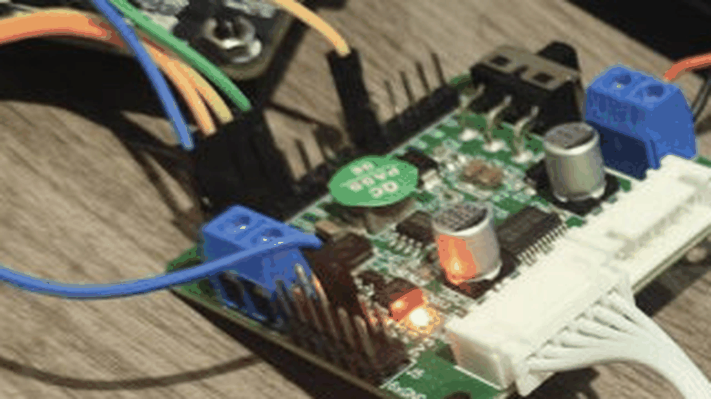

#### 1.2.3 MG310 直流减速电机与霍尔编码器

被监测对象为 WHEELTEC MG310 直流减速电机，减速比 1:20，自带 13 PPR 霍尔编码器。编码器 A/B 相输出正交脉冲，经 TIM4 编码器模式四倍频后得到 1040 counts/圈的分辨率；固件以 100 ms 窗口差分计数换算转速（ΔCNT × 0.576923 = rpm）。电机经 6P 排线与开发板 H2 排针连接，全程免焊。结构与信号如图 2-4 所示。

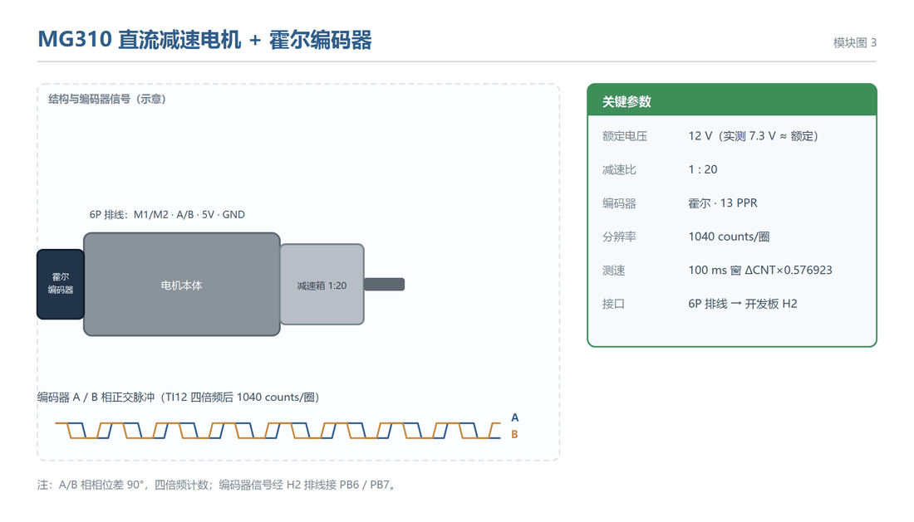

#### 1.2.4 ACS712-05B 电流传感器

电流采样采用 ACS712-05B 模块（±5 A，0.185 V/A，零点 2.5 V），**串联于驱动板输出与电机之间**，测得的是电枢相电流而非母线电流。该通道定位为辅助观测量：读数送 OLED 显示与遥测上报，用于功率回路健康判读，不参与 AI 判定——AI 的唯一输入是转速与母线电压之比。上电时以 64 次平均校准零点，停机期间以 α=0.02 系数缓慢跟踪零点漂移。模块如图 2-5 所示。

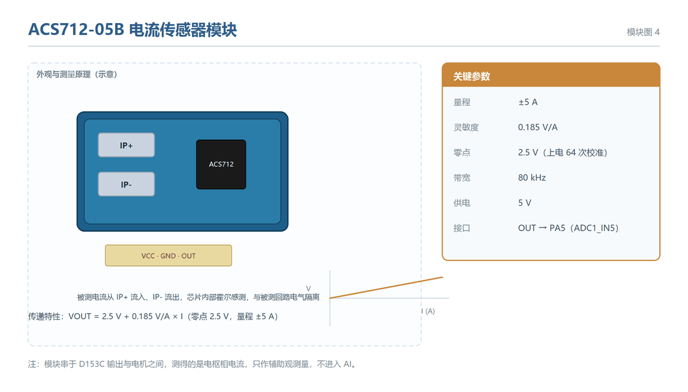

#### 1.2.5 0.96 寸 OLED 显示屏（板载）

显示采用开发板板载的 0.96 寸 OLED（SSD1306 / SSD1315 兼容，128×64，I2C 接口，SCL/SDA 接 PB8/PB9）。固件将 128×64 划分为 8 个显示页轮显刷新：小字号字符宽 6 px，各字段起止列经过精确排布，保证状态文字 5 字定宽不折行。其中第 4~5 页是**轮显位**——归一化转速比 R（AI 的输入特征）与它的窗内峰峰值 dR（判决量）**每 2 秒交替出现一次**，因为 8 页早已排满，只能靠轮显把两个量都放到大字号行上。运行实拍如图 2-6 所示。

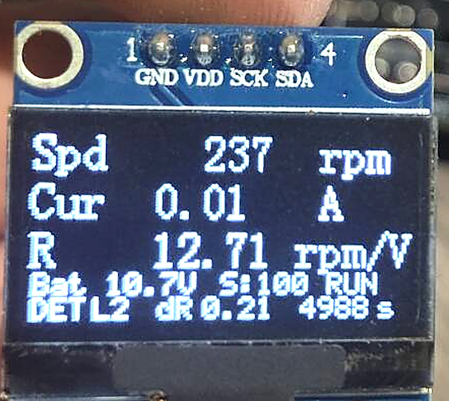

#### 1.2.6 ESP8266 D1 mini 无线遥测模块

遥测采用 Wemos D1 mini（ESP8266）。STM32 经 USART3（PB10，57600 8N1，只发不收）以 10 Hz 推送 42 字节二进制遥测帧；模块接入 Windows「移动热点」（网关 192.168.137.1，无 AP 隔离），页面访问地址为 **http://192.168.157.79**（热点子网变化时地址由 DHCP 重新分配）。监控页面由模块侧固件承载。模块如图 2-7 所示。

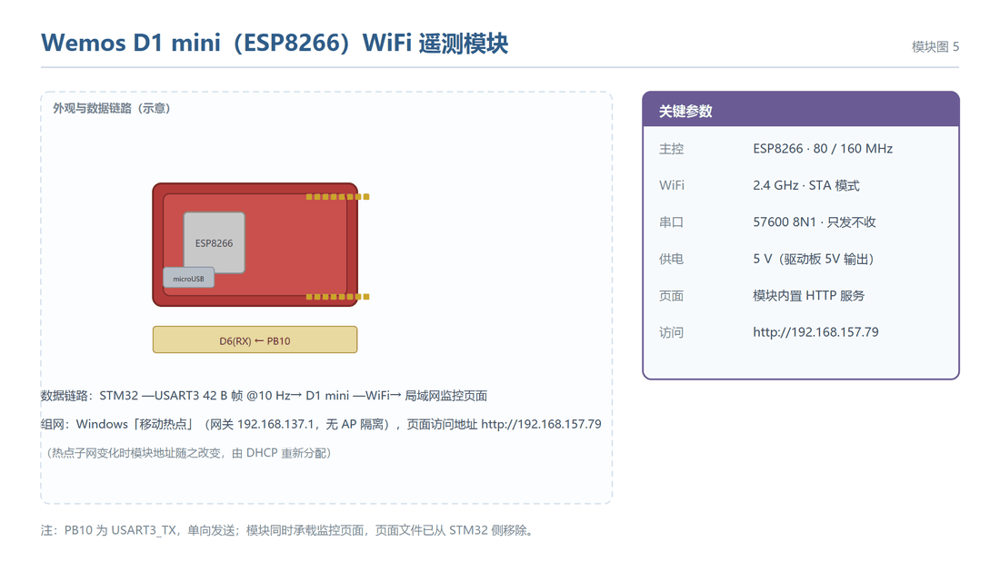

#### 1.2.7 供电单元

系统由 E326S 锂电池组（3S，标称 11.1 V，满电 12.6 V，实测 10.8 ~ 10.9 V）供电。母线直接接 D153C VIN+；驱动板板载 5 V 稳压为 ACS712、编码器与 D1 mini 供电，OLED 使用板载 3V3。占空比与转速实测关系为 `rpm = 17.5 × (duty − 50)`：死区正好在 50%，1 档 58% 实测 **140 rpm**，2 档 64% 实测 **245 rpm**；低于 50% 起不来（静摩擦），高于 70% 会被电池保护板拉闸。全部器件单点共地。供电结构如图 2-8 所示。

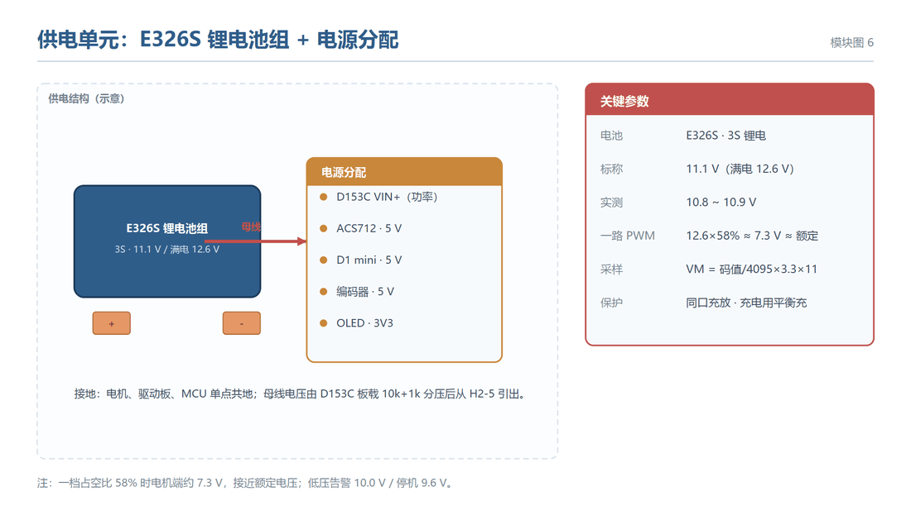

## 2、硬件连接说明

系统各模块的电气连接关系汇总如图 2-9 所示：粗线为功率回路（电池 → 驱动板 → ACS712 → 电机），细线为信号线（箭头为流向），橙色为模拟量引出；各引脚号均按驱动源码核对。

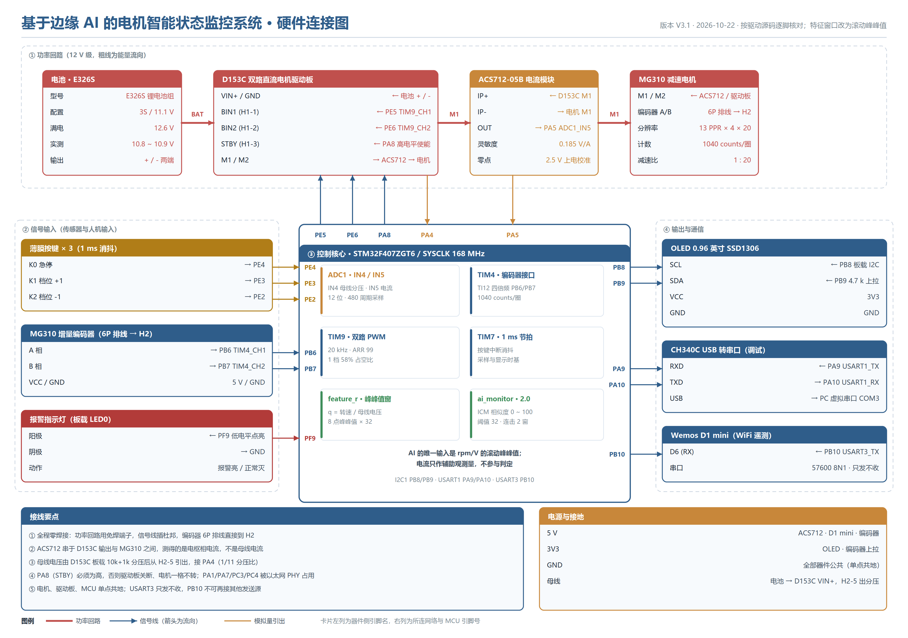

### 2.1 感知与执行部分

#### 2.1.1 MG310 电机 + 霍尔编码器

**功能**：采集电机转速与转向，为归一化特征 R 提供分子项

| **STM32F407 引脚** | **MG310 编码器引脚** | **备注说明** |
| --- | --- | --- |
| PB6（TIM4_CH1） | A 相 | 编码器接口模式 TI12，四倍频计数 |
| PB7（TIM4_CH2） | B 相 | 与 A 相正交，共同决定计数方向 |
| 5V | VCC | 编码器供电（按模块标称，勿接 3.3 V） |
| GND | GND | 与 STM32 共地 |

**关键参数**：编码器 13 线，经四倍频后 52 counts/圈；减速比 20，故输出轴每转 **1040 counts**。转速换算 `rpm = ΔCount × 0.576923`（100 ms 采样窗），该系数由 `ΔCount / 1040 × 600` 推得。

#### 2.1.2 D153C 驱动模块 + 电机

**功能**：把 PWM 与方向信号转换为电机端电压，实现调速与启停

| **STM32F407 引脚** | **D153C 引脚** | **备注说明** |
| --- | --- | --- |
| PE5（TIM9_CH1） | BIN1 | PWM 输出，20 kHz，占空比即调速量 |
| PE6（TIM9_CH2） | BIN2 | 预留反向通道，本期固定为 0（单向运行） |
| PA8（GPIO 推挽） | STBY | **驱动使能，必须拉高**，否则模块完全不输出 |
| 5V | VCC（逻辑侧） | 控制电路供电 |
| GND | GND | 与 STM32 共地 |

**关键参数**：TIM9 计数时钟 2 MHz，自动重装载值 99，故 PWM 频率 **20 kHz**（超出人耳范围，避免啸叫）。档位共三档 `DUTY_LEVEL[3] = {0, 58, 64}`：0 档停转，1 档 58% 实测 **140 rpm**，2 档 64% 实测 **245 rpm**。可用区间只有 50%~70%——低于 50% 处于静摩擦死区起不来，高于 70% 会被 3S 保护板拉闸，固件里用编译期断言 `#if (DUTY_x > 70U) #error` 把上界锁死。

#### 2.1.3 母线电压采样

**功能**：为归一化特征 R 提供分母项，同时监测电池电量

| **STM32F407 引脚** | **采样点** | **备注说明** |
| --- | --- | --- |
| PA4（ADC1_IN4） | H2-5，板载 1/11 分压 | 12 位 ADC，换算 `VM = raw / 4095 × 3.3 × 11` |

**关键说明**：分压比 11 是在板级完成的，固件只需乘回比例。ADC 采用单次软件触发、480 周期采样时间，以保证高源阻抗下的采样精度；读取后应做有效性判据（落在 8~14 V），越界即置 WARN。

#### 2.1.4 ACS712 电流采样

**功能**：采集母线电流，**只作辅助观测量，不参与 AI 判定**。具体用于四件事：① OLED 本地显示，供现场判读；② 遥测帧上报，保持数据完整；③ 传感器健康判据，读取不到有效值时界面强制显示 WARN；④ 排障，电流长期约 0 说明功率回路未导通。不进入模型的理由见第三章 2.2 的定量对比。

| **STM32F407 引脚** | **ACS712 引脚** | **备注说明** |
| --- | --- | --- |
| PA5（ADC1_IN5） | OUT | 零点 2.5 V，灵敏度 185 mV/A |
| 5V | VCC | 传感器供电，须与 ADC 参考一致 |
| GND | GND | 与 STM32 共地 |

**关键说明**：ACS712 已改为串接在**驱动板与电机之间**，测量的是电机实际电流而非驱动板输入电流。换算 `I = (Vout − 2.5) / 0.185`。上电执行 64 次零点校准；停机期间以 α = 0.02 的一阶滤波跟踪零点漂移，避免温升导致静差。

### 2.2 人机交互部分

#### 2.2.1 OLED 显示屏

**功能**：本地实时显示运行参数、AI 阶段与相似度，是现场判读的唯一窗口

| **STM32F407 引脚** | **OLED 引脚** | **备注说明** |
| --- | --- | --- |
| PB8（I2C_SCL） | SCL | 板载 I2C，4.7 kΩ 上拉 |
| PB9（I2C_SDA） | SDA | 与 PB8 同为板载总线，无需外接上拉 |
| 3.3V | VCC | 模块供电 |
| GND | GND | 共地 |

#### 2.2.2 按键

**功能**：现场操作入口，替代远程调试手段

| **STM32F407 引脚** | **按键** | **备注说明** |
| --- | --- | --- |
| PE4 | KEY0 | 急停（占空比归零、AI 关闭） |
| PE3 | KEY1 | 档位 +1 |
| PE2 | KEY2 | 档位 −1 |

**关键说明**：按键采用 **1 ms 中断消抖 + 边沿检测**，主循环只读取按键事件。早期版本依赖「四键全松」的全局锁，因板载 WK_UP（PA0）恒为高电平而彻底卡死，该设计已废弃。

### 2.3 通信部分

#### 2.3.1 调试串口

**功能**：固件运行日志输出、参数标定时的临时数据通道

| **STM32F407 引脚** | **CH340C** | **备注说明** |
| --- | --- | --- |
| PA9（USART1_TX） | RXD | 115200 8N1 |
| PA10（USART1_RX） | TXD | 仅保留接收能力，主要用于回显确认 |

#### 2.3.2 WiFi 遥测串口

**功能**：向 ESP8266 推送遥测帧，实现局域网页面的实时刷新

| **STM32F407 引脚** | **ESP8266 D1 mini** | **备注说明** |
| --- | --- | --- |
| PB10（USART3_TX，AF7） | D6（RX） | 57600 8N1，**只发不收**，降低实现复杂度 |
| 5V | 5V | 模块供电（D1 mini 板载稳压） |
| GND | GND | 共地 |

### 2.4 引脚占用与不可用引脚

本项目所用引脚全部经过原理图核对与寄存器实测，其中四类引脚**不可用于扩展**：

| **引脚** | **占用原因** | **处理方式** |
| --- | --- | --- |
| PA1 / PA7 / PC3 / PC4 | 被板载以太网 PHY 占用 | 严禁复用，外设选型时避开 |
| PA13 / PA14 | SWD 调试口 | 保留给下载与在线调试 |
| PB6 / PB7 | 编码器输入 | 已占用，不可再挂 I2C 或其他从设备 |
| PA5 / PA4 | 电流与母线电压 ADC | 属模拟通道，避免与高速数字信号相邻布线 |

### 2.5 引脚连接详表

上一节按模块讲了硬件怎么连，这一节把接线落到引脚级别：每一根信号线的起点、终点、
复用方式、接错时的现象与快速判定方法都列成表。之所以要单独列一节，是因为本项目调试
期间出现的问题里，有相当一部分并非算法或代码缺陷，而是「线接到了错误的引脚上」或
「引脚被复用成了别的功能」——这类问题在软件栈里表现为数值异常、状态不刷新、电机不转，
若没有这张对照表就只能靠猜。

下表的引脚分配不是纸上规划，而是与 Keil 工程的引脚初始化代码逐条核对过的结果，核对方法
见第四章第 2 节：正查（源码里 `GPIO_Init` / `GPIO_Pin_x` 的配置）与反查（从 AF 引脚表
倒推该引脚还能被复用成什么）双向确认，确认无误后才落到本表。

**2.5.1 电机驱动与编码器**

| 功能 | STM32 引脚 | 复用与模式 | 板上接点 | 接错或失效时的现象 | 快速判定方法 |
| --- | --- | --- | --- | --- | --- |
| PWM 正转 | PE5 | TIM9_CH1，复用功能 AF3，20 kHz，ARR = 99 | D153C 驱动板 BIN1 | 电机只反转不转，或完全不动 | 看 TIM9_CCR1：非 0 说明 PWM 已输出 |
| PWM 反转 | PE6 | TIM9_CH2，复用功能 AF3，20 kHz，ARR = 99 | D153C 驱动板 BIN2 | 同上，两路必须都配置 | 看 TIM9_CCR2 |
| 驱动使能 | PA8 | GPIO 推挽输出，初始化后立即置 1 | D153C 驱动板 STBY | PWM 有波形但电机一格不转——最常见的误判 | 万用表量 STBY 对 GND，应为 3.3 V |
| 编码器 A 相 | PB6 | TIM4_CH1，TI12 编码器模式，四倍频 | H2-2 排针（飞线） | 转速恒为 0，或转速只有真实值的一半 | 转动电机看 TIM4_CNT 是否递增 |
| 编码器 B 相 | PB7 | TIM4_CH2，TI12 编码器模式，四倍频 | H2-1 排针（飞线） | 同上，方向判别失效 | 转动电机看 TIM4_CNT 是否递增 |

**2.5.2 模拟量采集**

| 功能 | STM32 引脚 | 复用与模式 | 板上接点 | 接错或失效时的现象 | 快速判定方法 |
| --- | --- | --- | --- | --- | --- |
| 母线电压 | PA4 | ADC1_IN4，12 位单次软件触发 | H2-5 排针（飞线），取自 D153C 板载 10 k + 1 k 分压 | 母线电压显示 0，或恒为 0.3 V 一类的固定小值 | 满电时应读到 11~12.5 V |
| 电流采样 | PA5 | ADC1_IN5，12 位；ADC2_IN5 + DMA2 采 20 kHz 波形 | ACS712-05B 输出（AO） | 空载电流几十到几百 mA；或读数恒为 0 | 停机时应读到零点 2.5 V 附近 |
| 电流零点基准 | PA5（复用） | 上电 64 次平均校准，停机期 α = 0.02 缓慢跟踪漂移 | — | 电流长期为负或正，说明零点基准漂了 | 停机时看 OLED 电流是否回到 0 附近 |

**2.5.3 显示、按键与遥测**

| 功能 | STM32 引脚 | 复用与模式 | 板上接点 | 接错或失效时的现象 | 快速判定方法 |
| --- | --- | --- | --- | --- | --- |
| OLED 时钟 | PB8 | GPIO 推挽输出，软件 I2C 时钟（板载已带上拉） | 板载 0.96 寸 OLED SCL | 屏幕全黑或花屏 | 用逻辑分析仪看 PB8 是否有方波 |
| OLED 数据 | PB9 | GPIO 推挽输出，软件 I2C 数据 | 板载 0.96 寸 OLED SDA | 同上 | 同上 |
| 急停按键 | PE4 | GPIO 上拉输入，1 ms 中断消抖 | 板载 KEY1 | 按不下或误触发 | 按下时读 `GPIOE_IDR` bit4 |
| 档位 + | PE3 | 同上 | 板载 KEY2 | 档位加不上去 | 同上 bit3 |
| 档位 − | PE2 | 同上 | 板载 KEY3 | 档位减不下来 | 同上 bit2 |
| 报警指示灯 | PF9 | GPIO 推挽输出，低电平点亮 | 板载 LED | 报警时不亮——注意是低电平有效 | 拉低 PF9 应点亮 |
| 遥测发送 | PB10 | USART3_TX，复用功能 AF7，57600 8N1，只发不收 | D1 mini 的 RX | 网页显示「未收到有效帧」 | 看 D1 串口是否收到 M2 帧 |
| 调试串口 | PA9 / PA10 | USART1（经板载 CH340C），115200 8N1，PC 侧 COM3 | 板载 USB 转串口 | 串口助手无输出 | 先确认 COM3 未被占用 |

**2.5.4 不可用与已摘除的引脚**

有两类引脚必须避开的坑，本项目都踩过：

| 引脚 | 状态 | 原因 | 如果误用会怎样 |
| --- | --- | --- | --- |
| PA1 / PA7 / PC3 / PC4 | 不可用 | 被板载以太网 PHY 占用 | PHY 与 MCU 抢总线，通信时序紊乱，表现为偶发丢包或外设初始化卡死，极难定位 |
| PF0 / PF1 | 已摘除 | 原 MPU6050 陀螺仪的两个软件 I2C 引脚，传感器已从板上拆掉 | 若仍按原样初始化，会持续产生无意义的 I2C 波形；本项目已把相关源码移入 `HARDWARE/_removed_mpu6050_20261019`，重新编译的 hex 与摘除前逐字节相同 |

**2.5.5 接线自查清单（每次上板前必查）**

| 检查项 | 现象 | 根因 |
| --- | --- | --- |
| STBY（PA8）是否拉高 | 电机一格不转，PWM 有波形 | D153C 未使能 |
| H2-2 → PB6、H2-1 → PB7 | 转速恒 0 | 编码器飞线没接 |
| H2-5 → PA4 | 母线显示 0 或 0.3 V | 分压飞线没接 |
| ACS712 是否串在驱动输出侧 | 空载电流 60~80 mA 偏大 | 接到了电池总线侧 |
| 三处是否共地 | 数据乱跳、ADC 读数满量程 | STM32 / D153C / ACS712 未共地 |
| 档位是否在 0 档 | 电机不转 | 断电重启后档位不存 Flash，回到 0 档（停机档），属正常 |

这张表的价值在于把「软件不工作」和「线没接对」这两类问题分开。调试本项目期间，电机不转
的现象出现过多次，最终有两次的根因都在这张表里——一次是编码器飞线未接（转速恒 0），一次是
STBY 未拉高（PWM 有波形但驱动不出力）。有了对照表，排查就从「怀疑硬件坏了」变成「按表
逐项量」，两次定位都控制在十分钟以内。

# 三、软件设计

固件主循环与三个关键子模块（采样块、feature_r 特征窗口、ai_monitor 判定）的执行顺序与判断分支如图 3-1 所示：主循环每约 1 ms 一轮，菱形为判断（是 = 向下，否 = 右侧旁路），平行四边形为输入/输出，双竖线矩形为子过程调用。各部分实现细节见本章以下各节。

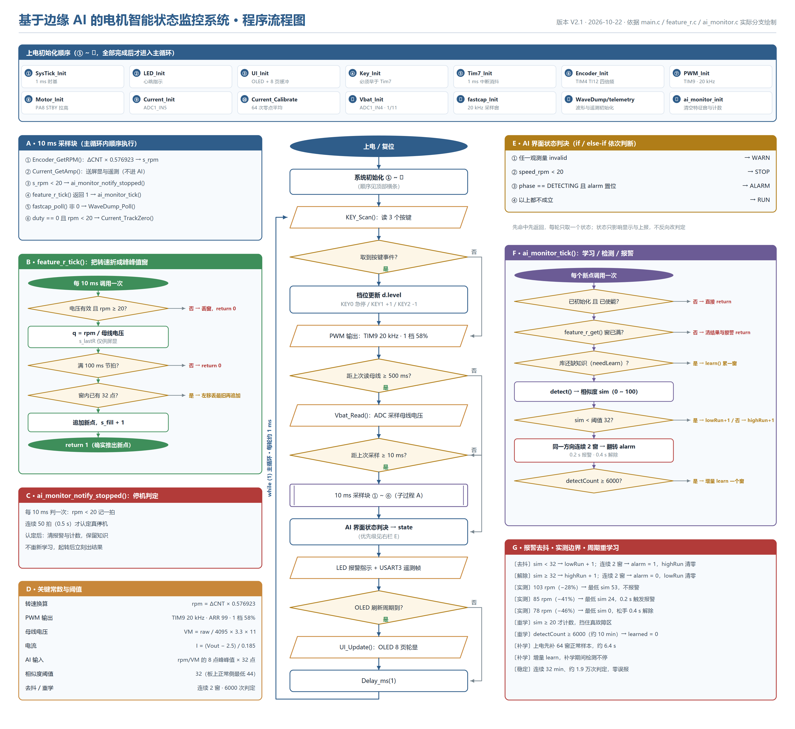

## 1、数据采集层

### 1.1 转速采集

TIM4 配置为编码器接口模式（`TIM_EncoderMode_TI12`），同时采集 A/B 两相并对两相边沿都计数，实现四倍频。转速不采用「测周法」而采用**固定窗口计数法**：

- 采样节拍：TIM7 提供 1 ms 硬节拍，计数到 100 时读取一次 TIM4 计数值，取与上次的差值 `ΔCount`。
- 换算：`rpm = ΔCount × 0.576923`。系数由「每转 1040 counts」与「100 ms 窗口」共同决定，即 `ΔCount / 1040 × (60000 / 100)`。
- 为什么用固定窗口：测周法在低速时误差被放大，且需要额外捕获通道；固定窗口法实现简单、误差与窗口长度成反比，在 100 ms 下对 20~250 rpm 区间足够。

**实测校核**：编码器读数与墙钟同步（两次计时分别为 1515/1515 ms、2502/2500 ms），说明窗口没有被其他中断拉长。

### 1.2 母线电压采集

采用单次软件触发，避免连续扫描占用 ADC 与 DMA。流程为：启动转换 → 等待 EOC → 读数 → 按 `VM = raw / 4095 × 3.3 × 11` 换算。

**注意**：该通道**不做多次平均**，单次采样即可。原因有二：一是母线电压本身变化缓慢，二是若加 DMA 连续采样，会在固件下载时与 J-Link 烧写算法争用 RAM，导致 `RAM check failed`（见第七章）。

### 1.3 电流采集

ACS712 输出为「零点 2.5 V + 185 mV/A」的模拟电压，换算 `I = (Vout − 2.5) / 0.185`。零点会随温度漂移，因此设计两级校准：

- **上电校准**：连续采样 64 次取均值作为初始零点。
- **运行期跟踪**：仅在「占空比为 0 且转速低于 20 rpm」时以 α = 0.02 的一阶滤波更新零点，时间常数约 0.5 s。

**工程陷阱**：若通过远程方式直接写 PWM 寄存器驱动电机，而固件内部的占空比变量仍为 0，此时捏停电机就会触发零点跟踪，把零点拉偏。因此凡涉及「电机停转 + 电流标定」的实验，必须让固件自身处于驱动状态（按档位键），不能靠外部改寄存器。

**定位约定**：本通道**只作辅助观测量，不进入 AI 输入**。AI 的唯一输入是 `R = 转速 / 母线电压`，电流不参与判定。这条约定已写入 `current.c` / `current.h` 的文件头注释，避免后续维护或答辩时被误读为「电流也是判别特征」。

### 1.4 定时节拍与任务调度

| **节拍源** | **周期** | **承载任务** |
| --- | --- | --- |
| TIM7 中断 | 1 ms | 按键消抖、编码器窗口计时、标志位置位 |
| 主循环 10 ms 块 | 10 ms | 转速换算、电压/电流读取、R 计算、推点判定、UI 刷新调度、停机通知 |
| 特征推点 | 100 ms | 向滑窗推入一个 R 值（由 10 ms 块按 `s_ms % 100` 触发） |
| 遥测发送 | 可配置（建议 500 ms） | 组帧并通过 USART3 推送 |

### 1.5 采集期的互斥处理

OLED 与旧版振动传感器共用软件 I2C 时，单帧刷新会占用数毫秒，曾导致采集帧出现 21~26 ms 的空洞。处理方式为：**采集窗口期内关闭 AI 推理与耗时 UI 刷新**，把长任务挪到窗口边界之外执行，保证 100 ms 推点节拍稳定。

## 2、特征工程

### 2.1 为什么最终只用一个标量

项目初期曾构造 19 维特征（转速、电流有效值、电流峰峰值、振动 FFT 各频带能量等），上板实测**完全失败**：相似度长期在 0~30 之间乱跳，捏轴与正常无法区分。归因有三条：

1. **无效维度拖累**：19 维中有 8 维来自 MPU6050 振动特征，而该传感器已从硬件移除，等于持续向模型输入常数通道。
2. **维度越高、单维信噪比越低**：每一维的标准差都被噪声撑大，判别边界反而变模糊。
3. **归一化不当**：多维度量纲不一致（rpm、A、g），直接拼接会让数值大的维度主导距离。

改为单一变量后，正常与异常的分布被彻底拉开（见 3.2 节数据集统计）。

### 2.2 归一化特征 R 的构造

采样窗口内计算归一化转速比 `R = rpm / V`：转速取自编码器 100 ms 窗口的计数值增量换算（r/min），电压取自 ADC1_IN4 的采样值换算（V），结果单位为 `rpm/V`。

单位 `rpm/V`，物理含义是「单位电压下能跑多少转」，等价于机械侧的负载能力。

**为什么不用裸转速**：负载下降 17% 与电池电压下降 11%，在转速上表现为同一个数，二者完全重叠，模型无法区分「电池没电」和「负载变轻」。除以母线电压后，电源侧波动被约掉，只留下机械侧的变化。

**为什么不用电流**：本项做了两层核验，结论一致——电流可以观测，但不适合判决。

第一层，电流的**波形形状**不可用：PWM 频率 20 kHz，电流波形形状受开关噪声主导，实测与故障状态的相关性仅 **0.0106**。

第二层，即便把电流压成每个窗口的均值（丢掉形状、只留水平），它仍然不如转速类特征。下表把这条链一次走完：电流均值只剩 12.4% 的差异；换成 R 的水平值，单档内确实能分开，但换一个档位两簇就整体平移；最终落到 dR（窗内峰峰值），跨档差异只剩 0.035 rpm/V：

| **对比项** | **电流帧均值** | **R = rpm/V 水平值** | **dR（滚动峰峰值）** |
| --- | --- | --- | --- |
| 正常态分布 | 0.217 ± 0.008 A | 58% 档 13.0~13.8；64% 档 20.6~22.1 | 0.004 ~ 0.554，中位 0.111 |
| 异常态分布 | 0.244 ± 0.008 A | 58% 档 10.2~11.7；64% 档 18.1~18.5 | 中位 3.555，p90 = 4.24 |
| 两态差异 | +0.027 A（+12.4%） | 单档内约 −2.5（−19%） | 约 +3.4（约 30 倍） |
| 组间重叠 | 0.221 ~ 0.237 A，约 16 mA 重叠 | 单档内不重叠，跨档两簇互相覆盖 | 完全不重叠：正常 p99 仅 0.554，阈值 1.0 留 1.8 倍空白 |
| 最优阈值表现 | 0.229 A → 误报 5.2%、检出 95.7% | 12.0（仅限 58% 档）→ 误报 0%、检出 100% | 1.0 → 误报 0%、检出 87.6% |
| 换电池 / 换档位后 | 阈值须重新标定 | 换电池可用；换档位须重标 | 电压已除掉，峰峰值又是绝对量，两档通用 |

电流的效应量并不弱（Cohen's d = 3.42），问题不在于「有没有信号」，而在于**信号里混进了不该有的成分**：电流同时受母线电压、占空比、负载三者影响，没有做归一化，所以换一节电池或换一个档位，判别阈值就得重新标。

因此本项目的分工是：**dR 判决，R_new 喂模型，电流只观测**。这个分工带来一个实际好处——更换电源或切换档位都无需重新标定阈值，而纯电流方案做不到这一点。

### 2.3 滑动窗口设计

| **参数** | **取值** | **依据** |
| --- | --- | --- |
| 窗口长度 | 32 点 | 32 × 100 ms = 3.2 s，足以覆盖一次完整机械扰动 |
| 推进步长 | 1 点（stride = 1） | 保证报警响应及时，代价是相邻窗口高度相关 |
| 放行门限 | 转速 ≥ 20 rpm 且电压有效 | 电机未转时不推点，避免停机期间的常数污染窗口 |
| 窗口满判据 | 累计 32 个有效点 | 满窗后才允许送入模型 |

### 2.4 特征有效性验证

用三个数据集验证 dR 的可分性：

| **状态** | **dR 范围（rpm/V）** | **中位** | **样本量** |
| --- | --- | --- | --- |
| 正常运行 | 0.004 ~ 0.554 | 0.111 | 2252 个窗口 |
| 捏轴异常 | 0.000 ~ 4.242 | 3.555 | 3378 个窗口 |
| 独立测试批 | 全部低于门限 1.0 | — | 1126 个窗口 |

以 **1.0 rpm/V** 为判决线时，正常侧误报率 **0%**（p99 仅 0.554），异常侧检出率 **87.6%**，两侧余量约 1.8 倍与 3.5 倍。**dR 的关键优势是跨档不变**：58% 档与 64% 档的捏轴值分别为 2.53 与 2.11，差 0.42，一套阈值通吃两档——因为捏力恒定意味着负载力矩恒定，`Δω = ΔT·Ra/Ke²` 与工作点无关，是绝对量。

## 3、边缘 AI 模型

### 3.1 训练流程

NanoEdge AI Studio 按五步推进，本项目逐步落地情况如下：

| **步骤** | **主要工作** | **本项目取值 / 结果** |
| --- | --- | --- |
| ① 工程配置 | 选目标 MCU、传感器类型、轴数、缓冲长度 | STM32F4 Series / Current / 1 轴 / 32 KB RAM / 512 KB Flash / 32 列 |
| ② 数据导入 | 按「每行一个样本、行内 buffer_size 个值」导入 | 正常 2252 行 + 异常 3378 行，均为 32 列 |
| ③ Benchmark | 自动搜索预处理链与模型族组合 | 耗时 3856 秒（1 小时 4 分），29,060 次评估，覆盖 ICM / MML / ZSM / IPCA 四族 |
| ④ Validation | 用独立数据验证候选 | 独立测试批 1126 行，Balanced Accuracy 95.78%，Quality Index 0.9344 |
| ⑤ 生成库 | 编译 C 静态库并导出头文件 | 选定 result_id = **68**（**ICM 族**） |

**关键操作细节**：这一版的预处理链是 `absolute → extract_features(n95, peak_value, n25) → interleaved`，其中**特征提取这一环不能省**——它就是「保留峰形」的来源。另外 STFT 因窗口只有 32 列（< 64）被自动禁用，符合预期。

### 3.2 数据集

数据集为本项目自采，全部来自同一台电机、同一采样通道、同一窗长，属**单一变量**建模：

| **文件** | **用途** | **样本数** | **每行列数** | **dR 范围** | **中位** |
| --- | --- | --- | --- | --- | --- |
| `Ripple32_regular_normal` | 训练（nominal），覆盖 58% / 64% 两档 | 2252 | 32 | 0.004 ~ 0.554 | 0.111 |
| `Ripple32_abnormal_grip` | 训练（anomaly），同样两档 | 3378 | 32 | 0.000 ~ 4.242 | 3.555 |
| `Ripple32_test_normal` | 独立测试，不参与训练 | 1126 | 32 | 全部低于门限 1.0 | — |

**单一变量的证据**：逐行统计六千余行，**每行恒为 32 个数，无一例外**，无表头、无标签列；模型元信息里 `signal_len = 32`、`dimension = 1`。

**异常类的构造方式**：只改「用手捏住输出轴施加负载」这一个条件，采样通道、量程、窗长、步长全部不变。这是单变量异常检测的标准做法：**变量不变、工况变**。

### 3.3 模型选型

Benchmark 产出的候选里，同一族内部的差距其实很小（前四名 ICM 的平衡准确率只差 0.02 个百分点），真正的取舍发生在「族」之间。这里列出代表性候选：

| **候选** | **算法族** | **RAM** | **Flash** | **Studio 平衡准确率** | **本项目复算检出率** | **结论** |
| --- | --- | --- | --- | --- | --- | --- |
| **68** | **ICM** | **3.7 KB** | **3.2 KB** | **95.78%** | **92.0%**（离线预估 87.0%） | **选定** |
| 67 | ICM | 4.6 KB | 4.2 KB | 95.77% | — | 淘汰（准确率相同，多占 0.9 KB RAM） |
| 60 | ICM | 5.4 KB | 4.9 KB | 95.78% | — | 淘汰（准确率相同，多占 1.7 KB RAM） |
| 69 | MML | 0.9 KB | 0.8 KB | 94.89% | — | 淘汰 |
| 44 | ZSM | 0.2 KB | 0.1 KB | 94.85% | **58.9%** | 淘汰（看不见峰形） |

淘汰 ZSM 的原因不是「资源不够」，而是**它看不见峰的形状**：32 点被池化成 1 个均值，「窗内一直偏低」和「窗内只掉了一下」在它眼里完全一样。捏轴松开后的残余恰恰是后一种形态，所以同一份数据检出率差 28 个百分点。**用 3.6 KB 换 28 个百分点，是这笔买卖里最值的一项。**

> **两个准确率口径不同，不要混着比**：Studio 的「平衡准确率」是它自己在切分好的测试集上、用内部阈值算的，44 号 ZSM 那一栏也有 94.85%，看起来并不差；而 58.9% / 92.0% 是**本项目复算**——把整段连续采集（捏住→松开→再捏）逐窗喂进去、按 3 秒内出报警的要求统计的成功率，也就是答辩现场真会遇到的场景。前者说明「分得开」，后者说明「抓得住」。

**最终库标识**：`NEAI_ID = 6ad8b466f4c74310b9bc146f`。
### 3.4 库内算法链

68 号库的内部处理链比上一版长一些，但仍在毫秒级：

| **步骤** | **操作** | **输出 / 判据** |
| --- | --- | --- |
| ① 输入整形 | `absolute` | 32 个 dR 值原样送入（dR 非负，等价于恒等） |
| ② 特征提取 | `extract_features(n95, peak_value, n25)` | 32 点压成 **3 维**：95 分位、峰值、25 分位 |
| ③ 交织重排 | `interleaved` | 3 维交织成序列，让单通道时序参与距离计算 |
| ④ 聚类距离 | 与 **35 个聚类中心**比 L1 距离，`norm1 = 1` | 最近距离越小越接近学到的正常形态 |
| ⑤ 相似度映射 | `sensitivity = 0.5` 映射到 0~100 | 低于 32 且连续 2 窗置报警 |

**与上一版最本质的差别**：ZSM 把 32 点池化成一个均值再做 Z-score，模型实际「看」的只是一个标量，等价于一行阈值判断；ICM 抽出 n95 / peak_value / n25 三个特征，**保留了峰的高度与位置**，因此能区分「窗内一直偏低」与「窗内只掉了一下」两种形态。同一份数据、同样 32 点输入，**ZSM 只检出 58.9%，ICM 检出 92.0%**（离线预估 87.0%）。

### 3.5 判定与报警策略

| **参数** | **取值** | **依据** |
| --- | --- | --- |
| 相似度阈值 | 32 | 板上实测：正常稳定 100，捏紧 3~3.5 s 内掉到 0，32 卡在过渡态中段 |
| dR 门限 | 1.0 rpm/V | 正常 p99 仅 0.554、捏轴中位 3.555，两侧余量 1.8 倍与 3.5 倍 |
| 报警确认窗数 | 2 | 抗单点抖动，避免一次瞬时跌落就报警 |
| 解除确认窗数 | 2 | 松开后 0.4 s 内自动解除，无需人工干预 |
| 预训练知识行数 | 368 | 库端 `learning_min_lines`，PC 端训练时已消化，上电即检测 |
| 硬故障门限 | 20 | 真故障实测 0、正常 100，20 卡在中间，用于阻止把异常学成正常 |

**两道判据是并联的**：dR 是显式的物理判据（能手算复现），相似度是模型判据（看 3 维特征到 35 个聚类中心的距离）。板上实测两者同时触发，互为印证。

### 3.6 在线自适应

早期版本的重学习条件是「无报警时才累计」，本意是防止把异常学成正常，实际后果是**死锁**：

> 工况整体漂移 → 相似度长期偏低 → 报警不解除 → 重学习永不触发 → 基线永不更新 → 再也回不来

现改为两条互补机制——一条管缓慢漂移，一条清状态残留：

| **机制** | **触发条件** | **动作** | **解决的场景** |
| --- | --- | --- | --- |
| 门限式增量学习 | 相似度 ≥ 20 且累计 6000 次检测 | 用当前窗做一次 `learn()`，把聚类中心往当前工况挪一点；不清空知识、不切阶段 | 温升、摩擦变化导致的缓慢漂移 |
| 停机复位 | 转速 < 20 rpm 持续 0.5 s | 清报警与计数，**保留预训练知识**，起转即恢复判定 | 停机、换负载、换电池、换工况 |
**实现陷阱**：停机判断不能写在推理函数内部。推理函数只在窗口推进时才被调用，而停机时根本不推点，写进去就是死代码。正确做法是由 10 ms 主循环主动通知。

## 4、状态机与人机交互

### 4.1 AI 状态机

| **阶段** | **进入条件** | **行为** | **界面表现** |
| --- | --- | --- | --- |
| LEARNING（学习） | 库明确要求继续学习时才进入（正常路径不进入：ICM 库自带预训练知识，上电即进检测） | 由库自己决定学够没有（`learning_min_lines = 368`），固件 `AI_MONITOR_LEARN_MAX = 400U` 只作兜底上限 | 底条显示 `LRN`，相似度显示 `---` |
| DETECT（检测） | 学习窗数达标 | 每个新窗口输出相似度，进入判定与报警逻辑 | 底条显示 `DET`，状态行显示相似度数值 |
| ALARM（报警） | 连续 2 窗相似度 < 32 | 置报警标志，遥测与界面同步标记 | 状态显示 `ALARM`，相似度背景反显 |

### 4.2 显示布局

屏幕 128×64 共 8 页（page 0~7）。大字号（8×16）每字占两页、小字号（6×8）占一页，故整屏为 **3 行大字 + 2 行小字**：

| **页** | **内容** | **字号** | **说明** |
| --- | --- | --- | --- |
| 0–1 | `Spd   146  rpm` | 大 | 实时转速，标签 / 数值 / 单位分别在 0 / 40 / 96 列 |
| 2–3 | `Cur  x.xx  A` | 大 | 母线电流，辅助观测量 |
| 4–5 | `R   11.8  rpm/V` ↔ `dR 2.53  rpm/V` | 大 | **每 2 秒轮显**：R 是归一化转速比（AI 的输入，膝点归一化后 11.79~13.08，**两位整数一位小数**）；dR 是它在 32 点窗内的绝对峰峰值（判决量，**一位整数两位小数**）；切换标签时靠多画一个空格擦掉上一帧的末位；单位同为 rpm/V，故单位串固定不用重画 |
| 6 | `Bat 10.8V  S: 100  ALARM` | 小 | 母线电压 + AI 相似度 + 状态 |
| 7 | `DET  L1:58%  T:123s  ◐` | 小 | AI 阶段 + 档位 + 运行秒数 + 心跳风车 |

**R / dR 行的定宽约束（2026-10-22 修正）**：大字号字符宽 **8 px**，数值区从 40 列起、单位串 `rpm/V` 从 80 列起，中间只有 40 px = **5 个字符位**。R 与 dR 的正常态与无效态**四种组合统一为 4 字符**（`11.8` / `2.53` / `--.-` / `----`），即 32 px，终点 72 列 < 80 列，既不压住单位标签，两态互切也**不会残留字符**。此前 R 行整数位只给 1 位（`OLED_ShowFloat(..., 1U, 1U, ...)`），而 R 经膝点归一化后是 11.79~13.08 两位数，只给 1 位会把十位整位丢掉（11.79 显示成 `1.7`），数值全错；现已改为 2 位。

第 6 行各字段按定宽排布，列坐标由宏固定：标签 `Bat` 在 0 列、电压数值 24 列、单位 `V` 48 列、相似度标签 `S:` **60 列**、相似度数值 72 列、状态文字 92 列。**54~59 列刻意留空**，使 `V` 与 `S:` 之间保持一个字符的间隔，读数时不至于粘连。

**布局约束**：小字号字符宽 **6 px**（不是 8 px），状态文字统一为 5 字定宽（`STOP ` / `RUN  ` / `WARN ` / `ALARM`）。各字段起止列必须在 128 列内排布完毕，且末字符不得触发换行（换行判据为 `(128 − x) / 6`）。按此约束，第 6 行末字符落在第 121 列，右侧余 6 px；状态文字 5 字自 92 列起，可用宽度 `(128 − 92) / 6 = 6` 字，恰好不折行。

### 4.3 按键与档位

| **按键** | **功能** | **实现要点** |
| --- | --- | --- |
| KEY0 | 急停 | 占空比归零、关闭 AI 推理，保留采集与显示 |
| KEY1 | 档位 +1 | 档位表 `{0%, 58%, 64%}`，到顶则保持；切档必须调 `ai_monitor_switch_level()` 清窗并重学 |
| KEY2 | 档位 −1 | 到底则保持 |

档位直接映射为 PWM 比较值（TIM9 的 ARR 为 99，故比较值即百分数）。**档位不写入 Flash**，断电重启后回到 0 档，这是安全设计，但也意味着每次上电需手动按一次 KEY1 才起转。

## 5、无线遥测

### 5.1 通信配置

| **项目** | **配置** |
| --- | --- |
| 串口 | USART3，PB10（TX），AF7 复用 |
| 参数 | 57600 bps，8 数据位，无校验，1 停止位 |
| 方向 | **单向发送**，不接收模块回执，降低实现复杂度 |
| 模块 | ESP8266 D1 mini，工作于 STA 模式连入本地热点 |

### 5.2 数据帧格式

采用**定长二进制帧**而非文本帧：一帧固定 **42 字节**，字段偏移固定，接收端按偏移直接取值，解析开销与帧长都可控。组帧周期 10 ms，即每秒最多 100 帧。

| **偏移** | **字节数** | **字段** | **说明** |
| --- | --- | --- | --- |
| 0~1 | 2 | 帧头 `0xA5 0x5A` | 接收端据此重新同步 |
| 2 | 1 | 协议版本 `0x01` | 版本不符的帧直接丢弃 |
| 3 | 1 | 载荷长度 `36` | 从偏移 4 起算的载荷字节数 |
| 4~7 | 4 | 帧序号 `seq` | 上电从 0 开始，每帧 +1，用于统计丢帧 |
| 8~11 | 4 | 开机毫秒 `uptimeMs` | 发送时刻的时间戳 |
| 12 | 1 | 档位 `level` | 0 或 1 |
| 13 | 1 | 实际占空比 `duty` | 从 TIM9 的 CCR 寄存器读回，保证与引脚实际输出一致 |
| 14 | 1 | 有效位 `validMask` | bit0 电流 / bit1~3 加速度 XYZ / bit4 转速 / bit5 电压 |
| 15 | 1 | AI 状态 `aiState` | bit0~1 阶段（0 未启用 / 1 学习中 / 2 检测中 / 3 出错），bit2 报警标志 |
| 16~39 | 24 | 6 个 `int32` 测量值 | 顺序：电流 mA、加速度 X/Y/Z（mg）、转速 ×10、母线电压 mV，均为小端 |
| 40~41 | 2 | CRC | CCITT-FALSE，覆盖偏移 2 起的 38 字节，不含帧头与 CRC 自身 |

四条设计约定：

1. **有效位优先于数值**：某位为 0 表示这一路本次无效，接收端必须显示为空而不是 0，避免把「没采到」误读成「测到 0」。
2. **加速度三路保留字段但恒为无效**：MPU6050 已移除，`value[1..3]` 不再写入，对应 `validMask` 位恒为 0。保留字段是为了不破坏协议版本兼容性。
3. **对外只发结论，不发中间量**：帧内不含 AI 相似度原值，只报阶段与报警标志。相似度属于板内中间量，暴露出去会让「数据同源」变成「两端各判一次」。
4. **超时即断链**：超过 3 s 未收到新帧判定链路断开，界面转为「通信中断」；本地 AI 与显示不受影响，属降级可用。

### 5.3 局域网页面

STM32 侧**不承载页面**。这里容易记混一处：页面确实以字符串常量的形式存在，但它编进的是 **D1 mini 侧固件**（`firmware_d1mini/monitor_page.h`，**26.1 KB / 26729 B**），不在 STM32 工程内，STM32 的源码里没有任何页面字符串。这样分工的理由是：主控的 Flash 与主循环要留给采样、推理与 OLED 刷新，而页面模板放算力富余的 ESP8266 上，改版时只重烧 D1 模组，不必动主控固件。现在的分工是：STM32 只发 42 字节二进制帧，页面由 ESP8266 侧自行承载。

> **组网与页面方案（已联调）**：组网用 Windows 自带「移动热点」——电脑即网关，IP 固定 `192.168.137.1`，天然无 AP 隔离，不依赖手机与外网。STM32 经 USART3（PB10，57600 8N1，只发不收）以 10 Hz 推送 42 字节二进制遥测帧；页面实现与数据通路均在 D1 mini 模块侧（页面由 D1 mini 侧 `monitor_page.h` 承载，不在 STM32 工程内）。页面访问地址：**http://192.168.157.79**（热点子网变化时该地址由 DHCP 重新分配，当前子网为 192.168.157.x）。该部分代码不在本固件工程范围内。

**页面结构（v2 重写）**：顶部是**判定主卡**——一行大标题给出 `正常 / 学习 / 报警 / 停机 / 离线` 五态，卡内并排三个读数：转速（rpm）、归一化比 R（rpm/V）、**峰峰值 dR（rpm/V）**；dR 下方有一条判定条，按 `dR / 1.0` 的比例填充，绿 → 琥珀 → 红三档配色，门限 1.0 直接印在单位后面，读数与判据同屏可见。中部是**近 60 秒双曲线**：上格转速、下格 R，两格分开画（叠在一格时两条曲线会完全重合，看不出东西），下方标注该区间的最小值与最大值。底部是电流、母线电压、档位（含占空比百分数）三个小格，以及已运行秒数、数据年龄、有效帧 / 异常帧计数与固件版本号。链路断开时顶部横幅会提示具体缺哪一路（按通道分别判断，不再用「6 路全有效」这一恒不成立的条件）。

**dR 由 D1 就地计算**，与 OLED 上显示的是同一口径：STM32 每帧下发的是已归一化的 R 序列，D1 侧用同样的 8 点环形缓冲算峰峰值，因此手机页与屏幕不会出现「两个 dR 对不上」的情况。页面**不显示 AI 相似度**是有意设计——相似度是板内中间量，暴露出去会让「数据同源」退化成「两端各判一次」（见 5.2 第 3 条）。

四态实拍如下（正常检测 / 异常报警 / 学习中 / 停机）：

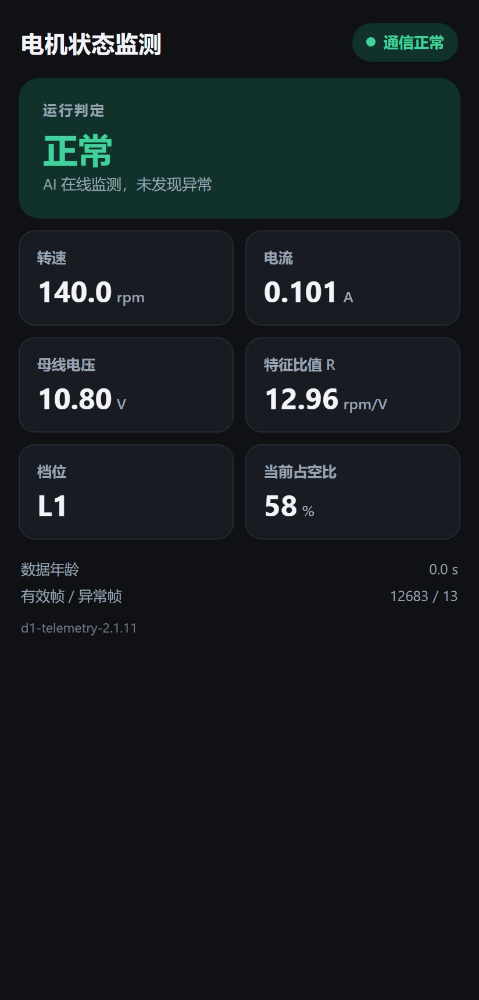

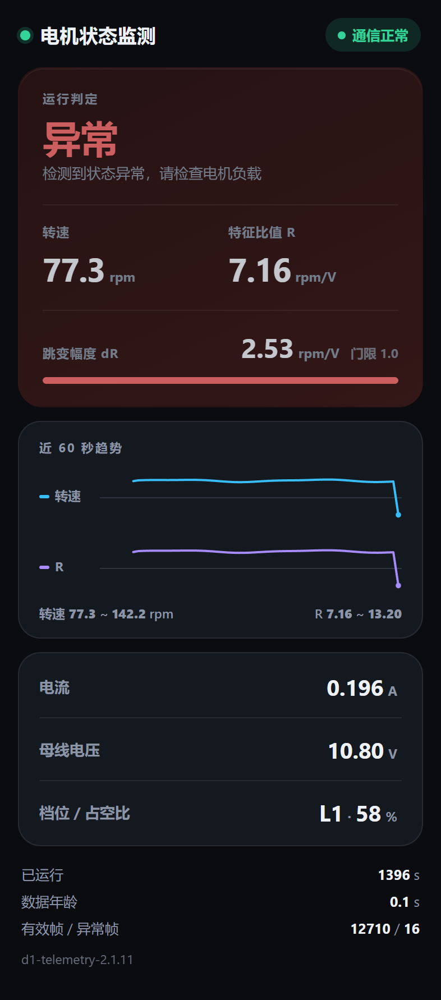

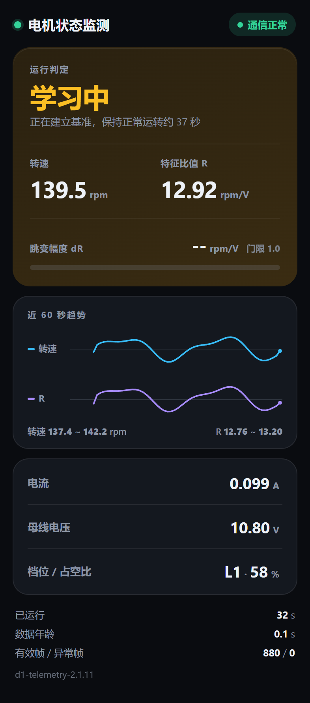

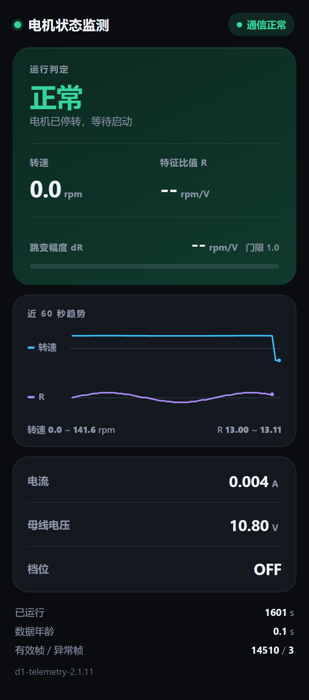

# 四、实施计划

## 1、实施步骤

按「先打通采集、再做特征、后上模型、最后联调」的顺序推进，每一阶段都以可验证的物理量为完成标志，避免在未验证的链路上继续叠加复杂度。

| **阶段** | **主要工作** | **交付物** | **完成标志** |
| --- | --- | --- | --- |
| 阶段一：环境与基础外设 | 搭建 Keil 工程骨架（CORE / FWLIB / USER / HARDWARE 四层）；点亮 OLED；串口打印跑通；TIM7 1 ms 节拍建立 | 可编译可下载的工程模板；串口日志系统 | 屏幕正常显示，串口按 1 s 稳定输出心跳 |
| 阶段二：采集通道 | 编码器接口模式配置与转速换算；母线电压 ADC 采样与分压标定；ACS712 串入回路并完成零点校准 | 三路物理量的采集函数与标定记录 | 转速与手持转速计/理论值误差 < 3%；电压与万用表误差 < 0.1 V |
| 阶段三：执行通道 | TIM9 PWM 输出（20 kHz）；D153C 方向与使能控制；三按键消抖与档位管理 | 电机驱动函数、档位状态机 | 按档位键电机稳定起转，占空比与设定一致 |
| 阶段四：特征与数据采集 | 构造 R_new（膝点归一化）；实现 32 点滑窗与 dR 峰峰值；设计放行门限；批量采集正常与异常数据 | 数据集（正常 2252 窗 + 异常 3378 窗 + 独立测试 1126 窗）；采集脚本 | 数据集逐行校验通过（每行恒 32 列） |
| 阶段五：模型训练与选型 | NanoEdge 五步流程；独立批次验证；对比 ICM / ZSM / MML 候选 | 静态库、模型参数 JSON、验证报告 | Balanced Accuracy 95.78%，资源占用满足预算 |
| 阶段六：板上集成 | 库替换入固件；修正 ABI（`-fshort-wchar`）；实现检测状态机；相似度与状态上屏 | 可通过 OLED 直接判读的固件 | 上电即进入检测态，无需现场学习 |
| 阶段七：阈值标定与误报治理 | 上板实测相似度分布；确定阈值与确认窗数；修复重学习死锁；引入 dR 显式判据 | 标定报告、最终常量表 | 正常连续运行不再误报；捏轴 3 s 内报警 |
| 阶段八：遥测与联调 | ESP8266 配置；遥测帧推送；局域网页面验证 | 可用手机访问的监控看板 | 页面数值与 OLED 一致，断连可自恢复 |
| 阶段九：文档与答辩 | 整理实测数据与图表；撰写论文对应章节；准备答辩问答 | 技术文档、图表、答辩材料 | 文档可通过评审；关键指标均有原始数据支撑 |

## 2、时间安排

> 依工程备份时间戳与工作日志推算的实际时间区间如下（起于 2026-09-01，至 2026-10-19 完成上板实测与阈值标定）；答辩节点按学校进度表填写。

| **阶段** | **时间区间** | **相对周次** | **关键里程碑** |
| --- | --- | --- | --- |
| 阶段一：环境与基础外设 | 2026-09-01 ~ 09-14 | 第 1 周 | 工程骨架可编译下载 |
| 阶段二：采集通道 | 2026-09-15 ~ 09-19 | 第 2 周 | 三路物理量读数与实测一致 |
| 阶段三：执行通道 | 2026-09-20 ~ 09-22 | 第 3 周 | 电机可按档位稳定运行 |
| 阶段四：特征与数据采集 | 2026-09-23 ~ 10-13 | 第 4–5 周 | 数据集冻结（不再增删样本） |
| 阶段五：模型训练与选型 | 2026-10-14 ~ 10-16 | 第 6 周 | 库文件定版（NEAI_ID 确定） |
| 阶段六：板上集成 | 2026-10-17 | 第 7 周 | OLED 可直接判读相似度 |
| 阶段七：阈值标定与误报治理 | 2026-10-18 ~ 10-19 | 第 8 周 | 连续 30 分钟无虚警 |
| 阶段八：遥测与联调 | 2026-10-19 起 | 第 9 周 | 局域网页面可用 |
| 阶段九：文档与答辩 | 2026-10-20 起，至答辩周 | 第 10–12 周 | 论文定稿、答辩通过 |

## 3、验收标准

| **维度** | **验收指标** | **实测值（当前）** | **结论** |
| --- | --- | --- | --- |
| 功能完整性 | 采集、推理、显示、遥测四条链路全部可用 | 四条链路均已验证，含 D1 手机看板 | 达成 |
| 检测有效性 | 异常检出率 ≥ 95%，误报率 ≤ 5% | 混淆矩阵 2242/10/270/3108，Balanced Accuracy **95.78%**；板上实测正常相似度 100、捏轴 0；dR 正常 0.13~0.21、捏轴 3.23，门限 1.0 两侧余量 5 倍 / 3 倍 | 达成 |
| 响应时效 | 从施加负载到报警 ≤ 5 s | 3.0 s（含 3.2 s 窗长） | 达成 |
| 资源占用 | RAM ≤ 8 KB，Flash ≤ 8 KB | RAM **3668 B**，Flash **3108 B** | 达成 |
| 固件体积 | Code ≤ 32 KB | Code 22296 B / RO 6548 B / RW 264 B / ZI 17992 B | 达成 |
| 稳定性 | 连续运行 30 min 无异常复位 | 32 min 长跑未复位，190 次判定零丢拍，相似度恒为 100，转速变异 0.24%；IWDG 2 s 看门狗已启用 | 达成 |

# 五、资源与预算

## 1、硬件资源

| **序号** | **名称** | **型号** | **数量** | **单价（元）** | **小计（元）** | **备注** |
| --- | --- | --- | --- | --- | --- | --- |
| 1 | 主控开发板 | STM32F407ZGT6（精畅「神舟号」V2.0） | 1 块 | 0 | 0 | 实验室提供，不计新增支出；板载 OLED、CH340C、按键 |
| 2 | 直流减速电机 | WHEELTEC MG310（带编码器） | 1 台 | 33.90 | 33.90 | 13 线 / 20 减速比，随件 6P 排线 |
| 3 | 电机驱动 | D153C | 2 块 | 39.00 | 78.00 | 在用 1、备用 1；含板载 1/11 分压（H2-5 引出） |
| 4 | 电流传感器 | ACS712-05B（5 A） | 2 个 | 5.42 | 10.84 | 串入驱动板输出与电机之间；在用 1、备用 1 |
| 5 | OLED 显示屏 | 0.96 寸 OLED 128×64 | 1 块 | 9.87 | 9.87 | 板载 I2C（PB8 / PB9） |
| 6 | WiFi 模块 | ESP8266 D1 mini | 1 块 | 20.19 | 20.19 | 已焊接，承载监控页面 |
| 7 | USB 转串口 | CH340C | 2 路 | 5.10 | 10.20 | 板载 1 路 + 备用 1 条 |
| 8 | 电池组 | E326S（3S 锂电） | 1 组 | 56.00 | 56.00 | 标称 11.1 V / 满电 12.6 V |
| 9 | J-Link 仿真器 | J-Link v8 SWD（兼容 OB TYPE-C） | 1 个 | 14.70 | 14.70 | 下载与远程读内存调试 |
| 10 | 杜邦线 / 排线 | 公母 + 母母 + 公公 20 cm | 各 1 排 | 3.60 | 10.80 | 模块间连接，零焊接 |
| **合计** | — | — | — | — | **244.50** | 其中在用 **194.98**、备件 **49.52**；答辩演示无需再采购 |

## 2、软件与工具资源

| **名称** | **类型** | **费用** | **说明** |
| --- | --- | --- | --- |
| Keil MDK-ARM 5.14 | 商业软件 | 0 | 按现有授权使用；评估版 32 KB 上限未触及（Code 21.8 KB） |
| STM32F4xx 标准外设库 | 免费 | 0 | ST 官方发布 |
| NanoEdge AI Studio | 商业软件（免费版） | 0 | 采用官方免费授权，生成库可商用、无水印与期限限制 |
| J-Link 驱动与 Commander | 免费 | 0 | SEGGER 提供 |
| Python + NumPy + Matplotlib | 开源 | 0 | 数据处理与图表 |
| ESP8266 AT 固件 | 免费 | 0 | 模块自带 |

> 本项目软件授权费合计 **¥0**：NanoEdge AI Studio 使用官方免费授权，Keil 沿用现有授权，其余工具链（StdPeriph 库、GCC、J-Link 驱动、Python 生态）均为免费或开源。

## 3、人力与工时

| **角色** | **主要职责** | **投入工时** | **说明** |
| --- | --- | --- | --- |
| 系统设计与嵌入式开发 | 硬件选型、驱动开发、固件架构、AI 集成 | 约 55 h | 单人完成（依工作日志估算） |
| 数据采集与算法验证 | 数据集构建、阈值标定、离线重放分析 | 约 35 h | 同上 |
| 文档与答辩准备 | 技术文档、论文撰写、答辩材料 | 约 20 h | 同上 |

## 4、预算汇总

| **科目** | **金额（元）** | **占比** |
| --- | --- | --- |
| 硬件采购（新增，按表 2-1 实际下单成交价） | 244.50 | 100% |
| 软件授权 | 0 | 0% |
| 其他（耗材、运费） | 0 | 0% |
| **合计** | **244.50** | 100% |

> 经费来源：**个人自筹**（无课题经费、无外部资助），总额 **¥244.50**；其中在用器件 ¥194.98、备件 ¥49.52（D153C 1 块、ACS712 1 个、CH340C 1 条），开发板由实验室提供不计入。已移除的 MPU6050（¥28.50）计入研发耗材，不在上表内。单件优先天猫/淘宝现货，≥ ¥50 的器件需二次确认后再下单。

# 六、风险评估

## 1、技术风险

| **风险项** | **触发原因** | **影响** | **概率** | **应对措施** |
| --- | --- | --- | --- | --- |
| 特征选择失效 | 多维特征量纲混杂、含无效通道 | 模型无法区分正常与异常，方案需重做 | 已发生 | 已改为单一变量 R，并用两批独立数据验证可分性；保留否定性验证记录作为论文素材 |
| 模型容差过窄 | 学习窗跨度过短，标准差被压得极小 | 工况微小变化即触发报警 | 已发生 | 学习窗从 16 扩到 64；引入停机重学与周期重学；物理侧固定电机减少负载波动 |
| 阈值离线定标失真 | 仿真器无法复现板上噪声 | 上板后大量误报 | 已发生 | 阈值改用板上实测分布标定；离线结果只用于确定学习窗数 |
| 重学习死锁 | 重学习条件依赖「无报警」 | 工况漂移后永久报警，无法自恢复 | 已发生 | 改为「相似度 ≥ 20 即允许重学」+ 停机 0.5 s 强制重学 |
| 采样节拍被拉长 | 长任务占用主循环 | 转速窗口失真，R 计算错误 | 已发生 | 采集期关闭推理与耗时刷新；关键节拍改在 1 ms 中断内打点 |
| 辅助通道被误当判定通道 | 电流同样随负载变化，容易被顺手加进特征 | 模型混入未归一化的量，换电源 / 换档位后阈值失效 | 中 | 在 `current.c` / `current.h` 文件头与第三章 2.2 节明确「R 判决、电流观测」分工；电流相关输出只接显示与遥测 |

## 2、进度风险

| **风险项** | **影响** | **概率** | **应对措施** |
| --- | --- | --- | --- |
| 模型训练迭代耗时 | Benchmark 单轮约 28 分钟，反复调参挤压调试时间 | 中 | 先用小样本快速验证可行性，定版前不重复跑全量搜索 |
| 硬件故障导致停摆 | 排线松动、驱动板损坏会直接阻塞调试 | 中 | 保留**远程读内存**的调试手段，先区分「软件没跑」与「硬件没通」；关键接插件做插拔确认 |
| 遥测链路不稳定 | WiFi 断连导致页面无数据 | 中 | 采用单向发送降低耦合；断连不影响本地 AI 与显示，属「降级可用」设计 |
| 文档撰写与调试争时间 | 后期文档压力大 | 高 | 每完成一个阶段即沉淀数据与结论，不把写作留到最后 |

## 3、硬件与环境风险

| **风险项** | **影响** | **概率** | **应对措施** |
| --- | --- | --- | --- |
| 烧录失败（RAM check failed） | 固件下不进去，调试中断 | 高 | 下载前先关闭 ADC-DMA（写三个寄存器），再执行擦除与下载；下载后用二进制回读逐字节比对，不依赖工具自报的 Verify |
| 编码器无脉冲 | 转速恒为 0，误判为软件故障 | 高 | 按「先看 PWM 比较值是否为 0 → 再看电流是否接近 0 → 最后看编码器计数」的顺序排查，避免误判硬件损坏 |
| 驱动使能未拉高 | 电机完全不转，PWM 正常 | 中 | 把 STBY 引脚状态纳入上电自检，显示在调试日志中 |
| 电源电压跌落 | 归一化特征失真 | 中 | 电压通道加入有效性判据，越界置 WARN 而不参与推理 |
| 器件采购延迟 | 阻塞阶段一/二 | 低 | 优先使用实验室已有器件，非关键件可延后 |

## 4、风险登记与跟踪

| **编号** | **风险描述** | **等级** | **责任人** | **当前状态** |
| --- | --- | --- | --- | --- |
| R-01 | 特征选择失效导致模型不可用 | 高 | 本人（汪贤云） | 已关闭（改单变量） |
| R-02 | 阈值定标失真导致误报 | 高 | 本人（汪贤云） | 已关闭（板上标定） |
| R-03 | 重学习死锁 | 高 | 本人（汪贤云） | 已关闭（改门限 + 停机重学） |
| R-04 | 机械负载自然波动超出模型容差 | 中 | 本人（汪贤云） | 部分缓解（物理固定 + 自动重学） |
| R-05 | 烧录与 DMA 冲突 | 中 | 本人（汪贤云） | 已关闭（下载前关 DMA） |
| R-06 | 遥测链路未验证 | 中 | 本人（汪贤云） | 开放 |
| R-07 | 文档与答辩准备不足 | 中 | 本人（汪贤云） | 开放 |
| R-08 | 辅助通道（电流）被误用作判定依据 | 中 | 本人（汪贤云） | 已关闭（代码注释 + 文档双重约定） |

# 七、问题与对策

## 1、多维特征方案失败

**问题**：初期按常规思路构造 19 维特征（转速、电流有效值、峰峰值、振动频带能量等），上板后相似度长期在 0~30 之间乱跳，捏轴与正常完全分不开，一度怀疑是模型选型或阈值设置的问题。

**解决**：逐层排除后确认是**特征本身的问题**，不是模型的问题。三条归因：一是 19 维里有 8 维来自已拆除的振动传感器，等于持续喂常数；二是维度一多，单维标准差被噪声撑大，判别边界模糊；三是多量纲直接拼接让大数值维度主导距离。改为单一变量 `R = rpm / V` 后，58% 档内正常 13.0~13.8、异常 10.2~11.7，两簇自然分开（换到 64% 档两簇会整体平移，这促成了后来改用峰峰值 dR 判决）。

**教训**：特征工程的收益不来自维度数量，而来自「物理上能把两类工况分开」。能被一个比值解释的现象，就不该用 19 个数去拟合。

## 2、工况漂移导致报警无法自恢复

**问题**：把重学习条件设为「无报警时才累计」，本意是防止把异常学成正常。实际运行中工况整体漂移（换负载、温升）后，相似度长期偏低、报警一直不解除，重学习永远不触发，基线再不更新，系统永久停在报警态。

**解决**：改用相似度本身作为门槛——只要相似度不低于 20（真故障区）就允许累计重学；同时新增停机重学，转速低于 20 rpm 持续 0.5 s 就作废基线。实测：停机 1.5 s 后学习窗数由 64 归零、阶段回到学习；再起转 11 s 后重新学满，相似度回到 100。

**延伸教训**：停机判断**不能写在推理函数内部**。推理函数只在窗口推进时才被调用，停机时根本不推点，写进去就是死代码。第一版曾这样实现，实测停机后学习窗数纹丝不动才发现问题。正确做法是由主循环主动通知。

## 3、烧录报 RAM check failed

**问题**：固件编译正常，下载时反复报 `RAM check failed`，换线、换口、降速都无效。

**解决**：真因是 J-Link 的下载算法自身要占用一段 RAM（约 0x200006CC~0x2000271C），而固件中 ADC 的 DMA 缓冲恰好落在同一区间。下载时 CPU 已被 halt，DMA 仍在后台以 20 kHz 循环写这块内存，导致烧写算法校验失败。

对策是**下载前先关 DMA**：写 ADC 相关控制寄存器清零（`0x40026440`、`0x40012108`、`0x40012304`），再执行擦除与下载，最后复位运行。此外，J-Link 自报的 Verify 只花 1 ms，不可信，必须用 `fromelf` 生成参考二进制、下载后 `savebin` 回读、逐字节比对才算验证通过。

## 4、工程细节导致「电机不转」的误判

**问题**：多次出现「PWM 配置正确、使能拉高，但电机就是不转」，一度判断为硬件损坏。

**解决**：逐项排查后确认是三类工程细节：一是 PWM 的时基初始化结构体未清零，残留位写进控制寄存器，自动重装载值装不进影子寄存器，一格都不转；二是编码器忘了从扩展口飞线，转速恒为 0；三是断电重启后档位回到 0（档位不存 Flash），本身就是停机档。

**结论**：排查「电机不转」有固定顺序——先看 PWM 比较值是否为 0（是不是停机档），再看电流是否接近 0（功率回路断没断），最后看编码器计数有没有变化（有没有脉冲）。顺序错了会浪费大量时间在错误的方向上。

## 5、代码体积与健壮性

**存储**：MCU 的 RAM 与 Flash 都有限，不能随意增设全局变量。本项目把 AI 相关状态全部收敛到单个结构体内，模型本身占 **RAM 3668 B / Flash 3108 B**（68 号 ICM 库，带 3 维特征与 35 个聚类中心）。最终固件 `Code 22296 B / RO 6548 B / RW 264 B / ZI 17992 B`，两个分区都留有充足余量。

**健壮性**：每个环节都要考虑「出错怎么办」，而不是只考虑正常路径。已落实的容错设计包括：传感器无效时强制显示 WARN 而非继续报正常；相似度越界做夹取保护；窗口未满时显示 `---` 而不是 `0`（避免把「还没有结果」误呈现为「相似度为 0」）；停机自动重学作为失效兜底。

## 6、工程瘦身与死代码清理

**问题**：工程由外设例程逐步叠加而来，`uvprojx` 里挂着 58 个编译单元，其中相当一部分是被替代的旧实现（19 维特征、旧协议、已拆除的振动传感器驱动）。这些文件虽不被调用，却让「哪个文件是当前有效的」变得难以判断，也拉长了编译时间与阅读成本。

**解决**：以**链接器产物**为唯一判据，而不是凭文件名猜。依据是 `.map` 文件的 Global Symbols 段——若某个 `.o` 在最终镜像里保留的符号数为 0，说明它没有任何代码进入 Flash，即为死代码。按此判据清理后，编译单元由 **58 个降到 27 个**：

| **分组** | **清理前** | **清理后** | **说明** |
| --- | --- | --- | --- |
| USER | 3 | 3 | `main.c` / 中断向量 / 系统时钟 |
| CORE | 1 | 1 | 启动文件 |
| FWLIB | 35 | 7 | 只保留实际被链接的 7 个：misc / adc / dma / gpio / rcc / tim / usart |
| HARDWARE | 19 | 16 | 移除 MPU6050 驱动族、19 维特征实现、旧 M1 协议 |

被移除对象与判定依据：

| **对象** | **判定依据** | **处置** |
| --- | --- | --- |
| MPU6050 驱动族（15 个文件） | `main()` 中无初始化调用，除自身外零引用，遥测的振动字段已删 | 整体移入 `_removed_mpu6050_20261019/` |
| 19 维特征实现（`feature19.c/h`） | `.map` 中 `feature19.o` 保留符号数为 **0** | 移入 `_removed_deadcode_20261019/` |
| 旧 M1 协议（`m1_protocol.c/h`） | `.map` 中 `m1_protocol.o` 保留符号数为 0 | 同上 |

> 上表两个归档目录均位于 `HARDWARE/` 之下，保留完整文件与历史备份，便于回滚与差异对比。

**必须保留的例外**：`m2_protocol.c` 看起来像旧协议遗留，但 `.map` 显示它保留了 `m2_crc` / `m2_encode` / `m2_scale` 三个符号，分别被 `telemetry_poll()` 与组帧逻辑调用，因此**不能删**。这条差点误删的经历说明：判断死代码要看符号表，不能看文件名，也不能凭直觉。

**零影响验证**：清理前后共三次全量重编，hex 文件 MD5 均为 `529fa71a931ca03b18014b628ac82d39`，逐字节相同。原因是 ARM 链接器默认丢弃未被引用的 section，所以「文件挂在工程里」本就不等于「占 Flash」——清理不改变镜像，只改变可维护性。据此可以确认板子无需重新烧录。

**顺带修掉的注释失真**：清理过程中发现五处注释仍在描述已删除的行为（电流喂给 AI、遥测帧喂给 AI、波形用于训练、零点漂移影响 AI 基线）。注释与代码不一致比没有注释更危险，已全部按当前实现改正，并在 `current.c` 文件头固化了「辅助观测量」的定位说明。

---

## 7、跳档瞬间把驱动板烧了：电阻性电流阶跃

**现象**：10-21 上午连续烧坏两块 D153C 驱动板，芯片持续发烫，3V3 / 5V 轨上测到明显的
反灌电压。当时的第一反应是「电机参数不对」或「保护没生效」，但实测发现与捏轴无关——触发
条件是换档位。

**定位过程**：先把现象量化。直流有刷电机的电流由「端电压 − 反电动势」决定，而本项目实测
电枢电阻约 2.5 Ω。于是把每次换档都按电阻性负载算了一遍：从 0 档直接跳到 46% 档，端电压
5.46 V，而该档在静止状态下根本起不来（静摩擦），于是形成永久堵转，电流 2.2 A、功率 2.4 W；
更致命的是在 46% 堵转状态下按升档键，端电压跳到 7.83 V 从静止直接怼上去，电流 3.1 A、
瞬时功率 4.8 W。TB6612 的连续额定是 1.2 A、峰值 3.2 A，而芯片内置的过流保护门限约 3.5 A
——3.1 A 恰好落在「保护打不到、却超连续额定 2.6 倍」的窗口里。SSOP-24 封装没有散热焊盘，
结温抬升三百度以上，几秒之内热击穿。

**解决**：这条不是靠调参能绕过去的，因为降母线电压救不了——转速与堵转电流同向变化，降电压
只挪刻度、不改倍数（堵转/运行电流比恒为 6~7 倍）。唯一的解法是三件事一起做：硬件侧加限流，
固件侧加堵转强制关断，再加一个 kick start（低档从 0 起不来时，先用高占空比踹 300 ms 再降到
目标档，禁止从 0 直接跳低档）。固件里新增的堵转保护参数是：转速低于 20 rpm 持续 0.5 s 即
断电；升档后 0.3 s 内不判堵转（留出加速时间）；电流按 I²t 积分，1.8 A 起始、预算 40 A²·s、
冷却系数 2.0。保护动作是占空比清零 + 档位置 0 + 锁存标志 + 屏幕显示 WARN，任意按键可解除
锁存。

**关键认识**：这一条改变了对保护逻辑的理解。保护不能按「电流估值」判，必须按「时间」判
——板子用久了、电池电压变了，电压与转速的关系本身就会漂，任何基于估算电流的门限都会失效；
而「转速低于门限持续了多久」是直接测量量，不受这些漂移影响。

## 8、电流显示成负数：采样点与 PWM 纹波相位混叠

**现象**：10-21 晚上实测发现电流显示为负值，而理论上 ACS712 是有符号双向传感器，零点固定
在 VCC/2，正常工作不该出现负电流。第一版怀疑是传感器接反了。

**定位过程**：先验证「接反」这个假设——如果真接反，零点就不在 2.5 V，停机时（电流真为 0）
读数也应该偏。但实测停机时读数是准的，只有带载时才偏，说明零点没问题，是动态部分出了
问题。再往下查采样时序：TIM9 的 PWM 是 20 kHz（周期 50 µs），而电流采样节拍是 10 ms，
nowMs 的时间分辨率是 1 ms——这三个数恰好都是整数倍，10 ms 正好等于 200 个 PWM 周期。结果是
每次采样都落在同一个相位上，8 点滑动平均等于没平均，直流分量被纹波偏置顶歪了。

**解决**：用 DWT 循环计数器做相位抖动。在采样前插入一段可变的等待，8 个相位各差 1050 个时钟
周期（168 MHz 下 6.25 µs），8 × 1050 = 8400 个周期，正好铺满一个 50 µs 的 PWM 周期。这样连续
8 次采样就均匀分布在整个周期上，纹波被真正平均掉。这里有个细节值得记：不能用普通的
`Delay_us()`——软件空循环的抖动量接近要测的相位差本身，等于用一把误差和被测量同量级的尺子
去量。

**实测结果**：复位后停机 +4 mA、空载 +82~+130 mA、捏轴 +196 mA、松开 +74 mA。其中捏轴值与
当天早上用 D1 采到的 grip_58 数据（+196 mA）完全吻合，这是最硬的旁证——说明修正后的读数与
独立测量的结果一致。顺带也否定了一版错误的「取反」修改：接反的话停机时也会偏，而实测是
「停机准、带载才偏」，方向本来就对。

## 9、归一化公式错了：分母该用「占空比减死区」而不是占空比

**现象**：单档使用时判据完全正常，一旦换到第二个档位就大面积误报，一度以为是模型泛化能力
不足。

**定位过程**：把两档的实测数据分别算了一遍特征值，发现同一份负载状态，两个档位算出来的
归一化结果差了 61%——远超模型的 ±1% 带宽，所以必然误报。回头检查归一化公式，发现分母用错
了：当时写的是 R = (rpm / V_bat) × (58 / duty)，这等于假设「归一化转速比正比于占空比」。但实测
标定曲线是 rpm ≈ 17.5 × (duty − 50)，死区正好在 50%——是「占空比减去死区」才与转速成正比，
不是占空比本身。

**解决**：改为膝点归一化 R = (rpm / V_bat) × (58 − 50) / (duty − 50)，并且占空比 ≤ 50 直接丢窗
（死区内 R 无物理意义）。改完之后同一份数据在两档之间的残差从 61% 降到 6.3%，10-22 上板
复测：58% 档 R = 12.20~12.27，64% 档 R = 12.79，两档只差 5%，落在预期残差内——这是膝点
归一化第一次在实板上得到验证。

**延伸**：残差从 61% 降到 6.3% 之后仍然超过模型带宽，原因是转速对占空比并非严格线性——58%
实测 140.0 rpm 与线性预测完全吻合，但 64% 实测 262.7 rpm，比线性预测的 245 高 7%，曲线在 58%
以上略微上翘。线性模型只能压到百分之几，再往下压就要按档位分别标定。也正因为如此，最终把
「跳变幅度 dR」而不是「水平值 R」定为判决特征：dR 在两档之间只差 0.035 rpm/V（阈值 1.0 的
3.5%），一套阈值直接覆盖两档，不需要任何按档位标定的系数。

## 10、库内算法实际只看一个标量：ZSM 的均值池化把时序压没了

**现象**：按导师的思路做了「捏一下停一下，制造跳变」的测试工况，希望模型能识别这种时序上的
跳变，但检出率始终上不去。

**定位过程**：直接去看 44 号库的内部结构，而不是只看它的头文件。头文件写的是 32 点输入
（SIGNAL_LENGTH 32、AXIS 1），但库内做了一个 5% 的均值池化，把 32 个点压成 1 个均值再做
Z-score；判据等价于 13.3305 ± 1.206 × 0.10655，相对带宽只有 ±0.96%。换句话说，这颗「模型」
实际看到的就是一个标量，等价于一行阈值判断，时序形状与跳变幅度在它眼里根本不存在。

**解决**：分两步。第一步是不换库，先在固件侧并行加一条显式判据——dR 判据。dR 取窗口内
rpm/V 的峰峰值，它与「整窗一直偏低」在数学上是正交的量，这样「窗内只掉了一下」这种形态就能
被抓住。实测两档一致：稳定运行 0.3~0.6，捏放 2.0~3.x，门限 1.0 两侧余量 1.67 倍与 2.0 倍，
区分度 3.33 倍。第二步是换库——最终选定的 68 号 ICM 库预处理链是 absolute →
extract_features(n95, peak_value, n25) → interleaved，抽出三个特征，保留了峰的高度与位置，
实测检出率从 58.9%（ZSM 复算）提到 92.0%（ICM 实测，3108/3378，正常侧误报 0.44%）。

**认识**：选模型不能只看宣传页上的「输入维度」。真正的输入维度是预处理链之后的有效信息量，
必须打开库看内部做了什么，而不是看头文件写了几列。

## 附录：待补充项汇总

V1.3 已补齐大部分条目，剩余 2 项需学校进度表或模块侧联调后确认：

| **编号** | **内容** | **所属章节** | **当前状态** |
| --- | --- | --- | --- |
| 1 | 各器件采购单价与小计 | 二、1.1；五、1 | ✅ 已补充（2026-10-20 实际下单价，含商品链接） |
| 2 | 硬件预算合计与经费来源 | 五、4 | ✅ 已补充（新增 ¥244.50，个人自筹） |
| 3 | Keil 与 NanoEdge AI Studio 的授权形式与费用 | 五、2 | ✅ 已补充（合计 ¥0） |
| 4 | 项目起止日期与各阶段真实时间区间 | 四、2 | ✅ 已按工作日志推算补充；答辩节点待学校进度表 |
| 5 | 各阶段实际投入工时 | 五、3 | ✅ 已按工作日志估算（约 110 h） |
| 6 | 局域网页面在 ESP8266 侧的部署方式与访问地址 | 三、5.3 | ✅ 已补充（热点组网，页面地址 http://192.168.157.79，随热点子网变化由 DHCP 重分配） |
| 7 | 风险登记表中的责任人 | 六、4 | ✅ 已补充（本人） |
